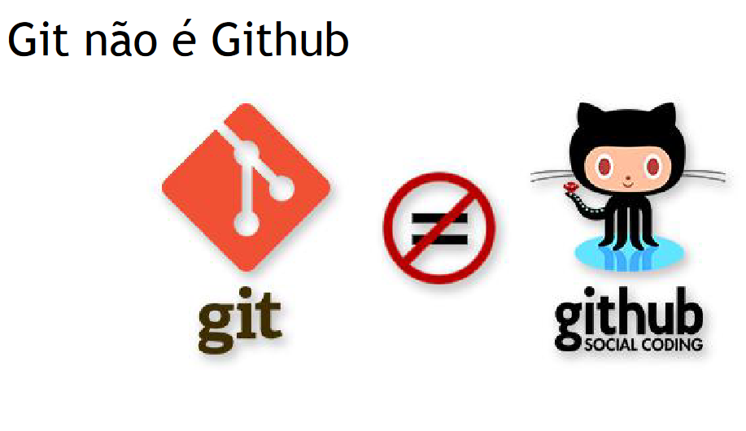

# 1.3 · Git não é GitHub

> **Em uma frase:** o **Git** é a ferramenta que controla as versões no seu computador; o **GitHub** é um site que guarda repositórios Git na internet e adiciona recursos de colaboração.

📄 [Material de apoio em PDF](img/PDF%20-%20Git%20não%20é%20Github.pdf)

## 🎯 A analogia que resolve a confusão

> **Git** está para o **GitHub** assim como a **foto** está para o **Instagram**.

Você tira e organiza fotos no seu celular sem precisar do Instagram. O Instagram é só um lugar na internet para **guardar, mostrar e interagir** com essas fotos. Da mesma forma:

- você usa o **Git** no seu computador mesmo sem ter conta no GitHub;
- o **GitHub** é um dos lugares onde você pode **hospedar** seu repositório Git para compartilhar e colaborar.

## 🛠️ Git

É um **programa** instalado no seu computador, usado pelo terminal (ou por extensões de editores).

- Controla o histórico de versões (commits).
- Permite criar e juntar branches.
- Funciona **100% offline**.
- É gratuito e open source.

## 🌐 GitHub

É uma **plataforma online** (um site) que hospeda repositórios Git. Hoje pertence à **Microsoft** (comprado em 2018).

- Guarda uma cópia do seu repositório na nuvem (o **repositório remoto**).
- Oferece recursos de colaboração: **issues**, **pull requests**, revisão de código, wikis etc.
- Tem interface web para navegar pelo código e pelo histórico.
- Integra com ferramentas de automação, como **CI/CD** (GitHub Actions).
- Também funciona como portfólio para desenvolvedores.

## ⚖️ Comparando lado a lado

| | Git | GitHub |
| --- | --- | --- |
| O que é | Programa (ferramenta) | Site / plataforma |
| Onde roda | No seu computador | Na internet |
| Precisa de internet? | Não | Sim |
| Para que serve | Controlar versões | Hospedar repositórios e colaborar |
| Alternativas | Mercurial, SVN | GitLab, Bitbucket |

> [!TIP]
> GitLab e Bitbucket são concorrentes do GitHub. Todos usam o **mesmo Git** por baixo, então o que você aprender aqui vale para qualquer um deles.

## 📌 Resumindo

- **Git** = ferramenta de controle de versão que roda no seu computador.
- **GitHub** = serviço online que hospeda repositórios Git e facilita a colaboração.
- Você pode usar Git sem GitHub, mas não faz sentido usar GitHub sem Git.

---

[⬅️ 1.2 O que é Git?](./1.2%20-%20O%20que%20é%20Git.md) &nbsp;|&nbsp; [🏠 Índice](../../README.md) &nbsp;|&nbsp; [1.4 Instalando o Git ➡️](./1.4%20-%20Instalando%20o%20Git.md)

