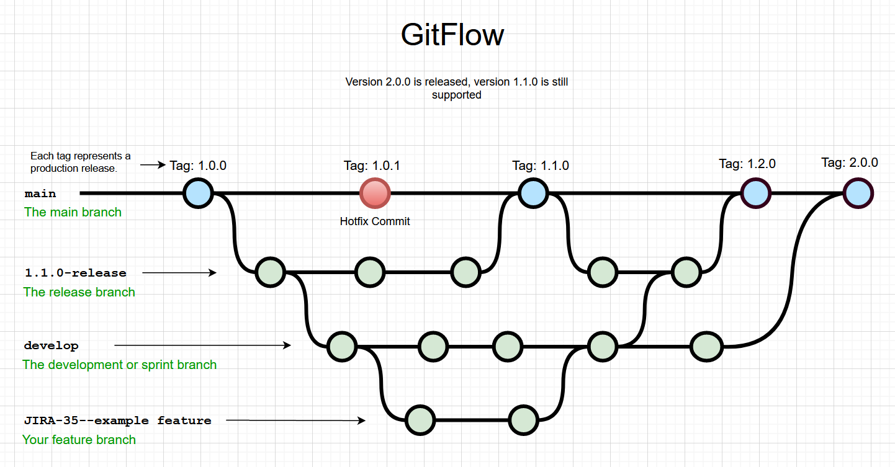

# 2.1 · Entendendo como o Git funciona

> **Em uma frase:** o Git tira "fotos" (snapshots) do seu projeto sempre que você pede, e guarda essas fotos em ordem dentro de uma pasta escondida chamada `.git`.



📄 [Material de apoio em PDF](img/PDF%20-%20Entendendo%20como%20Git%20funciona.pdf)

## 📦 1. Repositório

Um **repositório** (ou "repo") é simplesmente uma pasta de projeto que o Git está acompanhando. Você transforma qualquer pasta em repositório com:

```bash
git init
```

Esse comando cria uma pasta oculta chamada **`.git`**. É lá dentro que o Git guarda **todo o histórico** do projeto.

> [!WARNING]
> Nunca apague nem edite a pasta `.git` manualmente. Se ela for apagada, o histórico do projeto vai junto (os arquivos atuais continuam, mas o Git "esquece" tudo).

## 📸 2. Snapshots (commits)

Cada vez que você faz um **commit**, o Git tira uma **foto do estado de todos os arquivos** naquele momento e guarda essa foto no histórico.

- Arquivos que **não mudaram** não são copiados de novo: o Git só aponta para a versão que já tinha guardado. Por isso ele é tão leve.
- Cada commit recebe um **identificador único** (um *hash*, como `a1b2c3d`), usado para encontrar aquele ponto no histórico.
- Cada commit sabe qual foi o commit **anterior**, formando uma "linha do tempo".

```text
(commit 1) ← (commit 2) ← (commit 3)   ← você está aqui
```

## 🗃️ 3. As três áreas do Git

Este é o conceito mais importante para entender o Git. Todo arquivo passa por três "lugares":

| Área | Também chamada de | O que é |
| --- | --- | --- |
| **Working Directory** | Diretório de trabalho | A pasta do projeto, onde você edita os arquivos normalmente. |
| **Staging Area** | Área de preparação, *index* | Uma "sala de espera" onde você coloca as alterações que vão entrar no próximo commit. |
| **Repository** | Repositório local, `.git` | Onde os commits ficam guardados para sempre. |

```text
 Working Directory  ──git add──▶  Staging Area  ──git commit──▶  Repositório
   (você edita)                (você escolhe)              (fica registrado)
```

> [!TIP]
> **Analogia da mudança de casa:** a casa é o *working directory*; a caixa de papelão onde você vai colocando os itens é a *staging area*; quando você fecha a caixa com fita e escreve uma etiqueta, isso é o *commit*.

## 🌿 4. Branches (ramificações)

Uma **branch** é uma linha de desenvolvimento independente. Você pode criar uma branch para testar uma nova funcionalidade sem afetar a versão principal (normalmente chamada de `main`). Depois, se der certo, você junta essa branch na principal.

## 🔀 5. Merge (mesclagem)

**Merge** é o ato de juntar o trabalho de uma branch em outra. Na maioria das vezes o Git faz isso sozinho. Quando duas pessoas alteram **a mesma linha** do mesmo arquivo, acontece um **conflito**, que você resolve manualmente.

## ☁️ 6. Repositórios remotos

Até aqui, tudo acontece **no seu computador**. Um **repositório remoto** é uma cópia do projeto em um servidor (como o GitHub). Você usa:

- `git push` para **enviar** seus commits para o remoto;
- `git pull` para **trazer** os commits de outras pessoas para a sua máquina.

## 🕵️ 7. Histórico e rastreamento

Como cada commit guarda autor, data e mensagem, o Git consegue mostrar **toda a evolução do projeto**: quem mudou o quê, quando e por quê. Isso ajuda a encontrar a origem de bugs e a entender decisões antigas.

## 📌 Resumindo

- `git init` transforma uma pasta em repositório (cria a pasta `.git`).
- O Git guarda o projeto como uma sequência de **snapshots** chamados **commits**.
- Todo arquivo passa por três áreas: **Working Directory → Staging Area → Repositório**.
- **Branches** permitem trabalhar em paralelo; **merge** junta esse trabalho; **remotos** permitem compartilhar.

---

<div align="center">

[⬅️ 1.5 Usuários locais](../1%20-%20Introducao%20ao%20git%20e%20preparacao%20do%20ambiente/1.5%20-%20Registrando%20usuários%20locais%20no%20Git.md) &nbsp;|&nbsp; [🏠 Índice](../../README.md) &nbsp;|&nbsp; [2.2 Ciclo de vida dos arquivos ➡️](./2.2%20-%20O%20ciclo%20de%20vida%20dos%20status%20de%20arquivos%20no%20Git.md)

</div>
