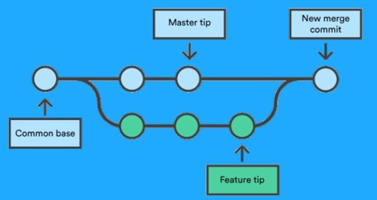

# 3.2 · Merge

> **Em uma frase:** merge é o comando que **junta** o trabalho de uma branch em outra, por exemplo, trazer a funcionalidade pronta da branch `feature` para a `main`.



## 🔀 Como o merge funciona?

Você terminou uma funcionalidade na branch `feature` e quer levá-la para a `main`. O passo a passo é:

```bash
# 1. Vá para a branch que vai RECEBER as alterações
git switch main

# 2. Traga as alterações da outra branch
git merge feature
```

> [!IMPORTANT]
> O merge sempre traz as alterações **para a branch em que você está**. Por isso, primeiro você vai para a branch de destino (normalmente a `main`) e, de lá, chama o merge.

## 🧬 Os dois tipos de merge

### 1. Fast-forward (avanço rápido)

Acontece quando a `main` **não teve nenhum commit novo** desde que a `feature` foi criada. O Git só "empurra" a etiqueta da `main` para frente. Não cria commit extra.

```text
Antes:                        Depois:
main:    A ── B               main/feature: A ── B ── C ── D
                \
feature:         C ── D
```

### 2. Merge de três vias (commit de merge)

Acontece quando **as duas branches** receberam commits novos. O Git combina tudo e cria um **commit de merge**, que tem **dois "pais"** (um de cada branch).

```text
main:    A ── B ── E ────── M   ← commit de merge
                \          /
feature:         C ── D ──
```

## ⚔️ E se der conflito?

Se as duas branches alteraram **a mesma linha** do mesmo arquivo, o Git não sabe qual versão manter e para o merge com um **conflito**. Você precisa:

1. Abrir o arquivo e escolher o que fica (veja a aula [4.7 Resolvendo conflitos](../4%20-%20Git%20avancado/4.7%20-%20Resolvendo%20conflitos.md)).
2. Marcar o conflito como resolvido com `git add <arquivo>`.
3. Finalizar o merge com `git commit`.

```bash
git add arquivo-com-conflito.txt
git commit
```

Desistiu no meio do caminho? Dá para cancelar o merge e voltar como estava antes:

```bash
git merge --abort
```

> [!NOTE]
> O `git merge --abort` só funciona **durante** um merge com conflito. Para desfazer um merge que **já foi concluído**, use `git reset` (se ainda não enviou) ou `git revert` (se já enviou).

## 🧰 Outros comandos úteis

```bash
# Lista apenas os commits de merge do histórico
git log --merges

# Mostra o que um commit de merge trouxe
git show <hash-do-merge>

# Lista as branches que JÁ foram mescladas na branch atual
git branch --merged

# Lista as branches que AINDA NÃO foram mescladas
git branch --no-merged
```

### Bônus: `git cherry-pick`

Às vezes você não quer a branch inteira, só **um commit específico** dela. Para isso existe o `cherry-pick` ("colher a cereja"):

```bash
git cherry-pick <hash-do-commit>
```

Ele copia aquele commit para a branch atual.

## 📌 Resumindo

- `git merge outra-branch` traz as alterações de `outra-branch` para a branch **atual**.
- **Fast-forward**: só avança o ponteiro. **Três vias**: cria um commit de merge.
- Conflito → resolva o arquivo → `git add` → `git commit` (ou `git merge --abort` para desistir).
- `git cherry-pick` copia um único commit de outra branch.

---

<div align="center">

[⬅️ 3.1 Branches](./3.1%20-%20Branches.md) &nbsp;|&nbsp; [🏠 Índice](../../README.md) &nbsp;|&nbsp; [3.3 Rebase ➡️](./3.3%20-%20Rebase.md)

</div>
