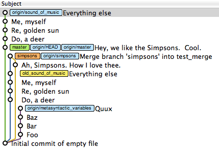

# 4.4 · Consultando o histórico de commits

> **Em uma frase:** você pode ver o histórico do projeto de três jeitos: pelo **terminal** (`git log`), por **interfaces gráficas** no editor ou pela **página do GitHub**.

## 💻 1. Pelo terminal: `git log`

```bash
git log
```

Mostra os commits do mais recente para o mais antigo, com hash, autor, data e mensagem.

### Variações mais usadas

```bash
# Uma linha por commit (visão geral rápida)
git log --oneline

# Filtrar por autor
git log --author="Maria"

# Filtrar por período (formato AAAA-MM-DD)
git log --since=2023-01-01
git log --until=2023-07-01

# Filtrar por palavra na mensagem
git log --grep="login"

# Combinar filtros
git log --oneline --author="João"

# Ver o histórico de um arquivo específico
git log --oneline -- caminho/do/arquivo.txt

# Ver quem alterou cada linha de um arquivo (e em qual commit)
git blame caminho/do/arquivo.txt
```

> [!TIP]
> Para todas as opções, consulte `git help log` ou revise a aula [2.5 Como consultar o histórico](../2%20-%20Git%20basico/2.5%20-%20Como%20consultar%20o%20histórico%20do%20projeto.md).

## 🖼️ 2. Por interfaces gráficas

Muitas ferramentas desenham o histórico como um **gráfico colorido**, onde cada linha vertical é uma branch e cada bolinha é um commit. Fica muito mais fácil enxergar quando as branches foram criadas e mescladas.


Algumas opções populares:

- Extensões do VS Code como **Git Graph**, **GitLens** e **Git History** (veja a [aula 6.1](../6%20-%20Criacao%20de%20curriculo%20online/6.1%20-%20Projeto%20de%20curriculo%20original%20e%20plugins%20do%20Git%20para%20Vscode.md));
- **GitHub Desktop**, **GitKraken**, **Sourcetree**;
- No próprio terminal: `git log --graph --oneline --all`.

## 🌐 3. Pela página do GitHub

No GitHub (e também no GitLab e no Bitbucket), dá para navegar pelo histórico direto no navegador:

1. Abra o repositório.
2. Clique no link de **commits** (ícone de relógio 🕒, perto do botão "Code").
3. Clique em qualquer commit para ver **exatamente** quais linhas foram adicionadas (verde) e removidas (vermelho).



> [!TIP]
> Dentro de um arquivo no GitHub, o botão **History** mostra só os commits que mexeram naquele arquivo, e o botão **Blame** mostra quem alterou cada linha.

## 📌 Resumindo

- **Terminal:** `git log` (e suas variações) e `git blame`.
- **Interfaces gráficas:** visualização em gráfico das branches e commits.
- **GitHub:** aba de commits, com o "diff" colorido de cada alteração.

---

<div align="center">

[⬅️ 4.3 Colaboradores](./4.3%20-%20Adicionando%20colaboradores%20no%20meu%20projeto.md) &nbsp;|&nbsp; [🏠 Índice](../../README.md) &nbsp;|&nbsp; [4.5 Desfazendo com checkout ➡️](./4.5%20-%20Desfazendo%20ações%20com%20checkout.md)

</div>
