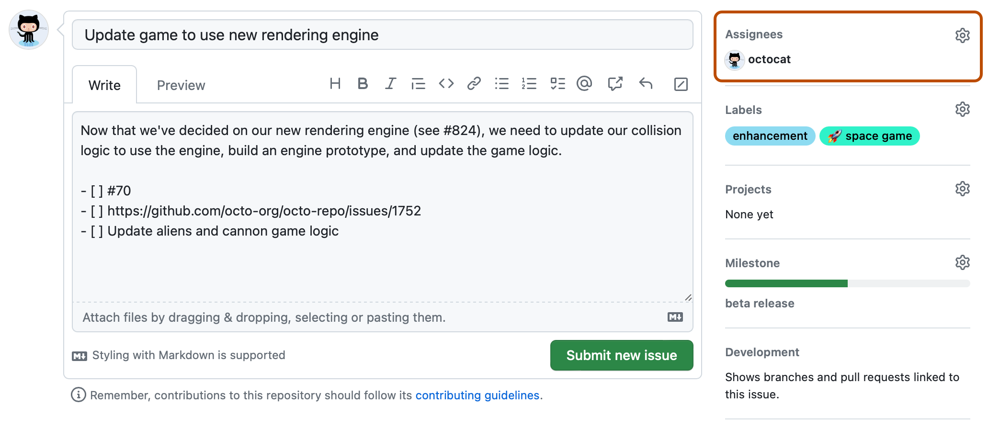

# 5.1 · O que são Issues?

> **Em uma frase:** issues são "tickets" no GitHub usados para relatar bugs, pedir funcionalidades, discutir ideias e organizar as tarefas de um projeto.



## 📋 Para que servem?

Pense nas issues como um **quadro de tarefas** ou uma **central de atendimento** do projeto. Elas ficam na aba **Issues** de cada repositório e servem para:

| Uso | Exemplo |
| --- | --- |
| 🐞 **Relatar bugs** | "O botão de login não funciona no celular" |
| ✨ **Pedir funcionalidades** | "Seria ótimo ter um modo escuro" |
| 💬 **Discutir ideias** | "Devemos trocar a biblioteca de gráficos?" |
| 👤 **Atribuir tarefas** | Designar uma pessoa responsável por resolver a issue |
| 🔗 **Ligar ao código** | Relacionar commits e pull requests com a issue |
| 📊 **Acompanhar o progresso** | Usar *labels* (etiquetas), *milestones* (marcos) e *projects* (quadros) |

Cada issue tem um **número** (ex.: `#42`), um título, uma descrição, comentários e um status: **Open** (aberta) ou **Closed** (fechada).

## ✍️ Como abrir uma boa issue

1. Vá até a aba **Issues** do repositório e clique em **New issue**.
2. Escreva um **título claro** que resuma o problema.
3. Na descrição, inclua:
   - o que você esperava que acontecesse;
   - o que aconteceu de verdade;
   - os **passos para reproduzir** o problema;
   - prints, mensagens de erro, sistema operacional e versão (se fizer sentido).
4. Clique em **Submit new issue**.

> [!TIP]
> Antes de abrir uma issue, **pesquise** se alguém já relatou o mesmo problema. Se já existir, comente nela ou reaja com 👍 em vez de criar uma duplicada.

## 🔒 Fechando uma issue automaticamente com um commit

O GitHub reconhece algumas **palavras-chave** em mensagens de commit (e em descrições de pull requests). Quando o commit chega à branch principal do repositório, a issue é **fechada automaticamente**.

### Palavras-chave aceitas

| Família | Variações |
| --- | --- |
| close | `close`, `closes`, `closed` |
| fix | `fix`, `fixes`, `fixed` |
| resolve | `resolve`, `resolves`, `resolved` |

Use a palavra seguida de `#` e o **número da issue**.

### Exemplo prático

```bash
# 1. Faça as alterações que resolvem a issue e prepare os arquivos
git add arquivo_modificado.py

# 2. Commit mencionando a issue #123
git commit -m "Corrige erro de divisão por zero no cálculo. Closes #123"

# 3. Envie para o GitHub
git push origin main
```

> [!NOTE]
> A issue só é fechada quando o commit chega à **branch padrão** do repositório (normalmente a `main`). Se você enviar para outra branch, ela fecha quando essa branch for mesclada na `main` (por exemplo, via pull request).

> [!TIP]
> Quer só **mencionar** a issue, sem fechá-la? Escreva apenas `#123` na mensagem (ex.: `"Adiciona testes iniciais (ref #123)"`). O commit vai aparecer na página da issue.

## 📌 Resumindo

- Issues são tickets para bugs, sugestões, discussões e tarefas.
- Cada issue tem número, status (aberta/fechada), comentários, labels e responsáveis.
- Uma boa issue explica o problema e como reproduzi-lo.
- `Closes #N`, `Fixes #N` ou `Resolves #N` no commit fecham a issue automaticamente.

---

<div align="center">

[⬅️ 4.7 Resolvendo conflitos](../4%20-%20Git%20avancado/4.7%20-%20Resolvendo%20conflitos.md) &nbsp;|&nbsp; [🏠 Índice](../../README.md) &nbsp;|&nbsp; [5.2 Fork ➡️](./5.2%20-%20Trabalhando%20com%20fork.md)

</div>
