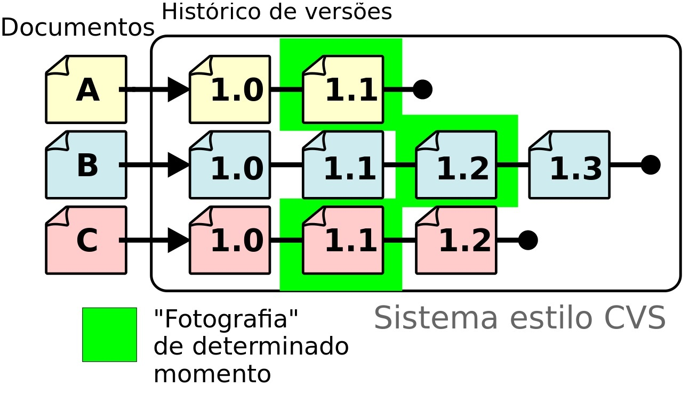

# 1.1 · O que é controle de versão?

> **Em uma frase:** controle de versão é um sistema que guarda o histórico de tudo o que muda nos arquivos de um projeto: **quem** mudou, **quando** mudou e **o que** mudou.



📄 [Material de apoio em PDF](./img/pdf-controle-de-versao.pdf)

## 🤔 Por que isso existe?

Imagine que você está escrevendo um trabalho e, para não perder nada, vai salvando cópias assim:

```text
trabalho.docx
trabalho_final.docx
trabalho_final_agora_vai.docx
trabalho_final_revisado_v2_DEFINITIVO.docx
```

Funciona... até não funcionar mais. Você não lembra o que mudou de uma cópia para outra, as cópias ocupam espaço e, se duas pessoas editarem ao mesmo tempo, vira uma bagunça.

Um **sistema de controle de versão** resolve esse problema. Pense nele como uma **máquina do tempo** para o seu projeto:

- 📜 **Guarda o histórico completo:** cada alteração fica registrada com autor, data e uma descrição.
- ⏪ **Permite voltar atrás:** se algo quebrou, dá para recuperar uma versão anterior.
- 👥 **Facilita o trabalho em equipe:** várias pessoas podem mexer no mesmo projeto ao mesmo tempo e depois juntar as alterações.
- 🧪 **Permite experimentar sem medo:** você pode testar uma ideia em uma "linha paralela" (uma *branch*) sem estragar a versão principal.

## 🗂️ Os dois tipos de controle de versão

### Centralizado

Existe **um único servidor central** com todo o histórico. Cada pessoa baixa só a versão atual dos arquivos, trabalha neles e envia as mudanças de volta para o servidor.

- ✅ Simples de entender.
- ❌ Se o servidor cair (ou você estiver sem internet), ninguém consegue registrar alterações nem consultar o histórico.
- Exemplos: **SVN (Subversion)** e **CVS**.

### Distribuído

**Cada pessoa tem uma cópia completa do projeto**, incluindo todo o histórico, no próprio computador.

- ✅ Dá para trabalhar offline e registrar alterações localmente.
- ✅ Se o servidor quebrar, qualquer cópia pode restaurar o projeto inteiro.
- Exemplos: **Git** e **Mercurial**.

| | Centralizado | Distribuído |
| --- | --- | --- |
| Onde fica o histórico | Só no servidor | Em cada computador |
| Funciona offline? | Não | Sim |
| Exemplos | SVN, CVS | Git, Mercurial |

> [!NOTE]
> O Git, que é o foco deste curso, é um sistema **distribuído**.

## 📌 Resumindo

- Controle de versão registra o histórico de alterações de um projeto.
- Ele permite voltar no tempo, trabalhar em equipe e experimentar com segurança.
- Existem dois modelos: **centralizado** (um servidor guarda tudo) e **distribuído** (cada pessoa tem uma cópia completa).

## 🏋️ Mão na massa

> Tente resolver antes de abrir a resposta. Os exercícios práticos usam a pasta `treino-git`, criada na aula 1.5.

**1.** Explique, com suas palavras, a diferença entre controle de versão **centralizado** e **distribuído**.

<details>
<summary>Ver resposta</summary>

No **centralizado**, só o servidor guarda o histórico completo; cada pessoa tem apenas a versão atual dos arquivos e depende do servidor para registrar alterações. No **distribuído**, cada pessoa tem uma cópia completa do projeto **com todo o histórico** no próprio computador.

</details>

**2.** O servidor da sua empresa caiu. Em qual dos dois modelos você ainda consegue ver o histórico e registrar novas alterações?

<details>
<summary>Ver resposta</summary>

No **distribuído** (como o Git). Como o histórico inteiro está no seu computador, você continua trabalhando normalmente e sincroniza com o servidor quando ele voltar.

</details>

**3.** Cite três problemas de controlar versões salvando cópias como `trabalho_final_v2_DEFINITIVO.docx`.

<details>
<summary>Ver resposta</summary>

Alguns exemplos:
- não dá para saber **o que mudou** de uma cópia para outra;
- não fica registrado **quem** mudou nem **por quê**;
- as cópias ocupam espaço e geram confusão sobre qual é a versão certa;
- quando duas pessoas editam ao mesmo tempo, juntar as alterações vira um trabalho manual e propenso a erros.

</details>

---

<div align="center">

[🏠 Índice](../../README.md) &nbsp;|&nbsp; [Próximo: 1.2 O que é Git? ➡️](./02-o-que-e-git.md)

</div>
