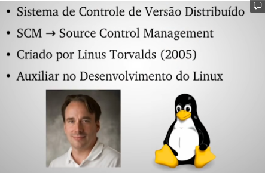

# 1.2 · O que é o Git?

> **Em uma frase:** o Git é o sistema de controle de versão **distribuído** mais usado do mundo. Ele roda no seu computador e registra todo o histórico do seu projeto.

📄 [Material de apoio em PDF](./img/pdf-o-que-e-git.pdf)

## 📖 Um pouco de história

O Git foi criado em **2005 por Linus Torvalds**, o mesmo criador do Linux. Ele precisava de uma ferramenta rápida e confiável para coordenar milhares de pessoas trabalhando no código do Linux ao mesmo tempo. Hoje o Git é praticamente o padrão do mercado.

## ⚙️ Como ele funciona (visão geral)

Como o Git é **distribuído**, cada pessoa tem no próprio computador uma cópia completa do projeto **com todo o histórico**. Isso significa que:

- você pode trabalhar e registrar alterações **sem internet**;
- quase todas as operações são **muito rápidas**, porque acontecem no seu disco e não em um servidor;
- se o servidor sumir, o projeto continua existindo nas máquinas de quem trabalha nele.

## 🧰 Principais recursos

| Recurso | O que significa, na prática |
| --- | --- |
| **Commits** (histórico) | Cada "ponto salvo" do projeto fica registrado com autor, data e uma mensagem explicando o que mudou. |
| **Branches** (ramificações) | Você cria linhas de trabalho paralelas para testar algo novo sem mexer na versão principal. |
| **Merge** (mesclagem) | Junta o trabalho feito em branches diferentes. |
| **Repositórios remotos** | Permite guardar uma cópia do projeto em servidores como **GitHub**, **GitLab** ou **Bitbucket** para compartilhar com outras pessoas. |
| **Velocidade** | Foi projetado para ser rápido mesmo em projetos gigantes. |

> [!TIP]
> Não se preocupe se termos como *commit*, *branch* e *merge* ainda parecem estranhos. Cada um deles tem uma aula própria mais à frente.

## ❓ Perguntas que o Git ajuda a responder

Durante o desenvolvimento, o histórico do Git permite responder perguntas como:

- **O que** mudou nesta versão?
- **Quanto** mudou?
- **Por que** mudou?
- **Quem** fez a mudança?
- **Quando** ela foi feita?
- Dá para **desfazer** ou **reproduzir** essa mudança?

> [!NOTE]
> Curiosidade: nos cursos de Computação, o controle de versão é estudado dentro de **Engenharia de Software**, na área de **Gerência de Configuração de Software**.

## 📌 Resumindo

- Git é um sistema de controle de versão distribuído, criado por Linus Torvalds em 2005.
- Cada pessoa tem o histórico completo no próprio computador, o que permite trabalhar offline.
- Os pilares do Git são: **commits**, **branches**, **merge** e **repositórios remotos**.

---

[⬅️ 1.1 Controle de versão](./01-controle-de-versao.md) &nbsp;|&nbsp; [🏠 Índice](../../README.md) &nbsp;|&nbsp; [1.3 Git não é GitHub ➡️](./03-git-nao-e-github.md)

