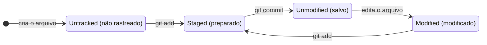
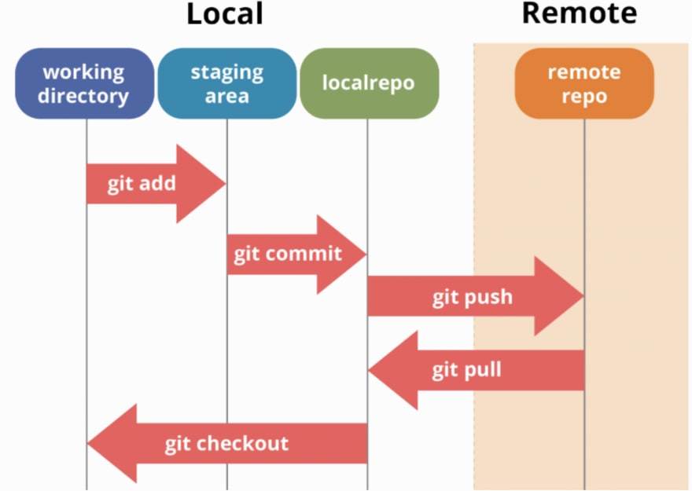

# 2.2 · O ciclo de vida dos status de arquivos no Git

> **Em uma frase:** todo arquivo do seu projeto está em um "status" (novo, modificado, preparado ou salvo), e os comandos do Git servem para mover o arquivo de um status para outro.

📄 [Material de apoio em PDF](./img/pdf-ciclo-de-vida-do-git.pdf)

## 🔄 Os status de um arquivo

Primeiro, o Git separa os arquivos em dois grandes grupos:

- **Untracked (não rastreado):** arquivos que o Git **ainda não conhece**.
- **Tracked (rastreado):** arquivos que o Git **já acompanha**. Um arquivo rastreado pode estar em um destes três status: *unmodified*, *modified* ou *staged*.

| Status | Em português | O que significa |
| --- | --- | --- |
| 🔴 **Untracked** | Não rastreado | Arquivo novo. O Git vê que ele existe, mas não guarda o histórico dele. Não entra nos commits até você usar `git add`. |
| ⚪ **Unmodified** | Não modificado | Arquivo rastreado que está **igual** à versão do último commit. Nada a fazer. |
| 🟡 **Modified** | Modificado | Arquivo rastreado que você **alterou** depois do último commit, mas ainda não preparou. |
| 🟢 **Staged** | Preparado | Alteração que você marcou com `git add` para entrar no **próximo commit**. |

### O ciclo, passo a passo



1. Você cria um arquivo novo → ele está **untracked**.
2. Você roda `git add` → ele vai para **staged**.
3. Você roda `git commit` → ele fica **unmodified** (salvo no histórico).
4. Você edita o arquivo → ele fica **modified**.
5. `git add` de novo → **staged**, e o ciclo se repete.

> [!TIP]
> Na dúvida sobre o status de qualquer arquivo, rode **`git status`**. É o comando que você mais vai usar no dia a dia, e ele sempre sugere o próximo passo.

## 🗺️ Do seu computador até o GitHub



Vamos percorrer o fluxo completo com os comandos principais.

### Passo 0: iniciar o versionamento

Abra o terminal **na pasta do projeto** e rode:

```bash
git init
```

A pasta agora é um repositório Git. Todos os arquivos que já estavam nela começam como **untracked**.

### Passo 1: ver o que mudou

```bash
git status
```

O Git lista os arquivos untracked (em vermelho), os modificados e os que já estão preparados (em verde).

### Passo 2: preparar as alterações (staging)

```bash
# Prepara um arquivo específico
git add nome_do_arquivo

# Prepara TODAS as alterações da pasta atual (e subpastas)
git add .
```

### Passo 3: registrar no histórico (commit)

```bash
git commit -m "Descreva aqui o que você fez"
```

Agora as alterações estão salvas no seu **repositório local**.

### Passo 4: conferir o histórico

```bash
git log
```

### Passo 5: enviar para o repositório remoto (GitHub)

```bash
# Conecta seu repositório local a um repositório no GitHub (só na primeira vez)
git remote add origin URL_do_repositório_remoto

# Envia os commits da sua branch para o GitHub
git push origin nome_da_branch
```

> [!NOTE]
> Os passos 1 a 4 acontecem **só no seu computador**. Só o passo 5 envia algo para a internet.

## 📌 Resumindo

| Comando | O que faz com o arquivo |
| --- | --- |
| `git init` | Começa a versionar a pasta |
| `git status` | Mostra o status de cada arquivo |
| `git add` | Untracked/Modified → **Staged** |
| `git commit` | Staged → **Unmodified** (salvo no histórico) |
| `git push` | Envia os commits locais para o remoto |

## 🏋️ Mão na massa

> Tente resolver antes de abrir a resposta. Os exercícios práticos usam a pasta `treino-git`, criada na aula 1.5.

**1.** Na pasta `treino-git`, crie um arquivo `ola.txt` com qualquer texto e rode `git status`. Em qual status ele está?

<details>
<summary>Ver resposta</summary>

**Untracked** (não rastreado). O `git status` mostra o arquivo em vermelho na seção *Untracked files*.

</details>

**2.** Leve o `ola.txt` até um commit e depois edite o arquivo de novo. Qual é o status depois de cada comando?

<details>
<summary>Ver resposta</summary>

```bash
git add ola.txt                  # → staged
git commit -m "Adiciona ola.txt" # → unmodified ("nothing to commit")
# edite o arquivo e salve         → modified
git status
```

</details>

**3.** Qual é a diferença entre `git add ola.txt` e `git add .`?

<details>
<summary>Ver resposta</summary>

`git add ola.txt` prepara **só aquele arquivo**. `git add .` prepara **todas** as alterações da pasta atual e das subpastas (arquivos novos, modificados e removidos).

</details>

---

<div align="center">

[⬅️ 2.1 Como o Git funciona](./01-como-o-git-funciona.md) &nbsp;|&nbsp; [🏠 Índice](../../README.md) &nbsp;|&nbsp; [2.3 .gitignore ➡️](./03-gitignore.md)

</div>
