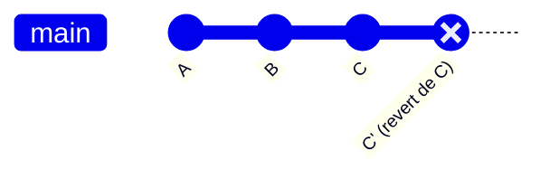

# 2.6 · Voltando no tempo com o Git

> **Em uma frase:** existem três formas principais de "voltar no tempo" no Git: **visitar** um commit antigo (`checkout`), **apagar** commits do histórico (`reset`) ou **desfazer** um commit criando outro (`revert`).

Antes de qualquer coisa, descubra o **hash** do commit para onde você quer voltar:

```bash
git log --oneline
# a1b2c3d Adiciona rodapé
# 9f8e7d6 Cria página inicial   ← quero voltar para cá
# 1234abc Commit inicial
```

Você só precisa dos primeiros caracteres do hash (ex.: `9f8e7d6`).

## 1️⃣ `git checkout <hash>`: só olhar o passado

```bash
git checkout 9f8e7d6
```

Seus arquivos voltam a ficar **exatamente como estavam** naquele commit. É como abrir um álbum de fotos antigo: você pode olhar, rodar o projeto, testar... sem apagar nada.

Você fica em um estado chamado **"detached HEAD"** (HEAD desanexado), ou seja, não está em nenhuma branch.

- Para **voltar ao presente**: `git checkout main` (ou `git switch main`).
- Se quiser **trabalhar a partir daquele ponto**, crie uma branch nova:

  ```bash
  git switch -c minha-correcao
  ```

> [!WARNING]
> Commits feitos em "detached HEAD" sem criar uma branch ficam "soltos" e podem ser perdidos quando você voltar para a `main`.

## 2️⃣ `git reset`: voltar e tirar commits do histórico

O `reset` move a branch atual para um commit anterior. Os commits que vieram depois **somem do histórico** da branch. O que acontece com as alterações desses commits depende da opção:

| Opção | Os commits somem? | As alterações vão para... | Risco |
| --- | --- | --- | --- |
| `--soft` | Sim | **Staging area** (prontas para commitar de novo) | 🟢 Baixo |
| `--mixed` (padrão) | Sim | **Working directory** (modificadas, mas fora do staging) | 🟢 Baixo |
| `--hard` | Sim | **Lugar nenhum: são apagadas** | 🔴 Alto |

```bash
git reset --soft 9f8e7d6
git reset 9f8e7d6          # igual a --mixed
git reset --hard 9f8e7d6
```

> [!CAUTION]
> `git reset --hard` **apaga** as alterações sem pedir confirmação. Use só quando tiver certeza absoluta.

## 3️⃣ `git revert <hash>`: desfazer de forma segura

```bash
git revert a1b2c3d
```

Em vez de apagar o commit, o Git cria um **novo commit que faz o contrário** daquele. Se o commit original adicionou uma linha, o revert remove essa linha.



O histórico fica intacto e todo mundo consegue ver o que foi desfeito. Por isso, o `revert` é a forma **mais segura** de desfazer algo que **já foi enviado** para o GitHub.

## 🧭 Qual usar?

| Situação | Comando |
| --- | --- |
| Só quero **ver** como o projeto estava | `git checkout <hash>` |
| Quero desfazer commits que **ainda não enviei** para o GitHub | `git reset` |
| Quero desfazer um commit que **já está no GitHub** / compartilhado | `git revert` |

> [!TIP]
> Antes de operações que mexem no histórico (como `reset --hard`), crie uma branch de backup: `git branch backup-antes-do-reset`. Se algo der errado, seus commits continuam lá.

## 📌 Resumindo

- `checkout <hash>`: visita o passado sem alterar nada (detached HEAD).
- `reset`: volta a branch e remove commits; `--soft` e `--mixed` mantêm as alterações, `--hard` apaga.
- `revert`: cria um commit que desfaz outro, preservando o histórico (ideal para o que já foi compartilhado).
- Os detalhes de cada comando são aprofundados nas aulas [2.8](./08-desfazendo-acoes.md), [4.5](../04-git-avancado/05-desfazendo-com-checkout.md) e [4.6](../04-git-avancado/06-revert-e-reset.md).

## 🏋️ Mão na massa

> Tente resolver antes de abrir a resposta. Os exercícios práticos usam a pasta `treino-git`, criada na aula 1.5.

**1.** No `treino-git`, visite o **primeiro** commit, veja como os arquivos estavam e volte para o presente.

<details>
<summary>Ver resposta</summary>

```bash
git log --oneline        # copie o hash do primeiro commit (o último da lista)
git checkout <hash>      # os arquivos voltam no tempo (detached HEAD)
git switch main          # volta ao presente
```

</details>

**2.** Você descobriu um erro em um commit que **já está no GitHub**. Qual comando é o mais seguro para desfazê-lo?

<details>
<summary>Ver resposta</summary>

`git revert <hash>`. Ele cria um novo commit que desfaz o anterior, sem reescrever o histórico que outras pessoas já baixaram.

</details>

**3.** Qual é a diferença entre `git reset --soft HEAD~1` e `git reset --hard HEAD~1`?

<details>
<summary>Ver resposta</summary>

Os dois desfazem o último commit. O `--soft` **mantém** as alterações na staging area, prontas para um novo commit. O `--hard` **apaga** as alterações.

</details>

---

<div align="center">

[⬅️ 2.5 Histórico do projeto](./05-historico-do-projeto.md) &nbsp;|&nbsp; [🏠 Índice](../../README.md) &nbsp;|&nbsp; [2.7 Comandos úteis ➡️](./07-comandos-uteis.md)

</div>
