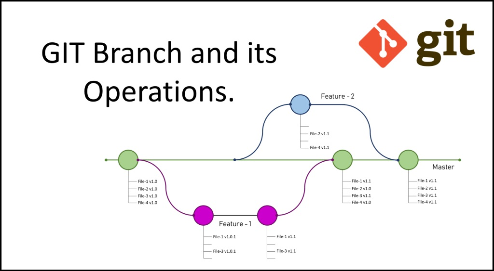
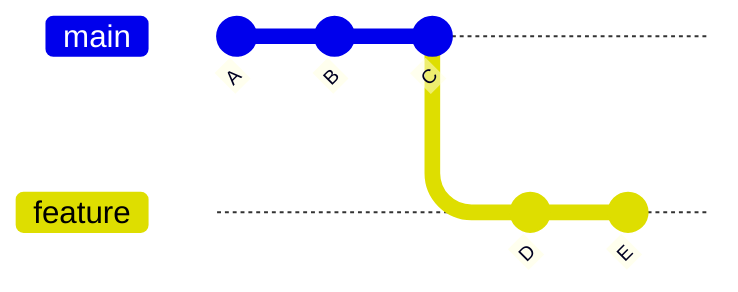

# 3.1 · Branches

> **Em uma frase:** uma branch é uma "linha do tempo paralela" do projeto, onde você pode trabalhar à vontade sem mexer na versão principal.



## 🌳 O que é uma branch?

Imagine que seu projeto é um livro. A branch `main` é a versão oficial. Você quer testar um final alternativo, mas sem estragar o livro original. Então você faz uma **cópia de rascunho**, escreve o final novo nela e, se ficar bom, incorpora ao livro oficial. Se ficar ruim, é só jogar o rascunho fora.

Uma branch é esse rascunho, com uma grande vantagem: ela é **leve e instantânea**. Por baixo dos panos, uma branch é só um **ponteiro** (uma etiqueta) que aponta para um commit. Quando você faz um novo commit na branch, a etiqueta avança junto.



> Nos diagramas, cada bolinha é um commit e cada cor é uma branch. Aqui, a branch `feature` nasceu do commit `C` e recebeu os commits `D` e `E`, enquanto a `main` continua parada em `C`.

### Quando usar branches?

- Desenvolver uma **nova funcionalidade** sem afetar o código que já funciona.
- **Corrigir um bug** de forma isolada.
- **Experimentar** uma ideia sem compromisso.
- Permitir que **várias pessoas** trabalhem ao mesmo tempo, cada uma na sua branch.

> [!NOTE]
> A branch principal costuma se chamar **`main`** (em projetos mais antigos, **`master`**). É a versão "oficial" do projeto.

## 🛠️ Comandos essenciais

### Ver as branches

```bash
# Lista as branches locais (a atual aparece com * na frente)
git branch

# Lista também as branches do repositório remoto
git branch -a

# Mostra só o nome da branch atual
git branch --show-current
```

### Criar uma branch

```bash
git branch nome-da-branch
```

Isso **só cria** a branch. Você continua na branch em que estava.

### Trocar de branch

```bash
# Forma moderna (recomendada)
git switch nome-da-branch

# Forma tradicional (ainda muito usada)
git checkout nome-da-branch
```

### Criar e já trocar para a nova branch

```bash
# Forma moderna
git switch -c nome-da-branch

# Forma tradicional
git checkout -b nome-da-branch
```

> [!TIP]
> Antes de trocar de branch, faça commit (ou guarde) suas alterações. Se houver mudanças não salvas que conflitem com a outra branch, o Git não deixa trocar, para você não perder trabalho.

### Renomear uma branch

```bash
# Renomeia uma branch específica
git branch -m nome-atual novo-nome

# Renomeia a branch em que você está
git branch -m novo-nome
```

### Excluir uma branch

```bash
# Exclui apenas se ela já foi mesclada (seguro)
git branch -d nome-da-branch

# Força a exclusão, mesmo sem merge (cuidado!)
git branch -D nome-da-branch
```

> [!NOTE]
> Você não consegue excluir a branch em que está. Troque para outra antes.

### Ver o histórico de uma branch

```bash
git log nome-da-branch

# Visualizar todas as branches em forma de gráfico
git log --graph --oneline --decorate --all
```

### Juntar uma branch na atual

```bash
# Estando na main, traz as alterações da feature
git switch main
git merge nome-da-branch
```

Isso é o **merge**, assunto da [próxima aula](./02-merge.md).

## 📌 Resumindo

| Comando | O que faz |
| --- | --- |
| `git branch` | Lista as branches |
| `git branch nome` | Cria uma branch |
| `git switch nome` | Troca de branch |
| `git switch -c nome` | Cria e troca de branch |
| `git branch -m novo-nome` | Renomeia a branch atual |
| `git branch -d nome` | Exclui uma branch já mesclada |
| `git merge nome` | Junta a branch `nome` na branch atual |

## 🏋️ Mão na massa

> Tente resolver antes de abrir a resposta. Os exercícios práticos usam a pasta `treino-git`, criada na aula 1.5.

**1.** No `treino-git`, crie a branch `feature-saudacao`, troque para ela e confirme em qual branch você está.

<details>
<summary>Ver resposta</summary>

```bash
git switch -c feature-saudacao
git branch --show-current     # feature-saudacao
```

</details>

**2.** Crie um arquivo `novo.txt`, faça commit **nessa branch** e volte para a `main`. O arquivo `novo.txt` continua na pasta? Por quê?

<details>
<summary>Ver resposta</summary>

**Não.** O commit existe só na branch `feature-saudacao`. Ao trocar para a `main`, o Git deixa a pasta como a `main` está, e lá o arquivo ainda não existe. Volte para a `feature-saudacao` e ele reaparece.

</details>

**3.** Renomeie a branch para `feature-boas-vindas` e depois tente excluí-la estando na `main`. O que acontece?

<details>
<summary>Ver resposta</summary>

```bash
git branch -m feature-saudacao feature-boas-vindas
git branch -d feature-boas-vindas
```
O Git **recusa** a exclusão (*"not fully merged"*), porque a branch tem commits que ainda não estão na `main`. Para forçar, seria `-D`. (Não exclua agora: vamos usar essa branch na próxima aula.)

</details>

---

<div align="center">

[⬅️ 2.8 Desfazendo ações](../02-git-basico/08-desfazendo-acoes.md) &nbsp;|&nbsp; [🏠 Índice](../../README.md) &nbsp;|&nbsp; [3.2 Merge ➡️](./02-merge.md)

</div>
