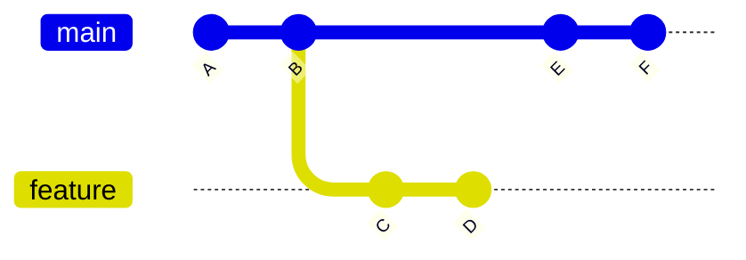
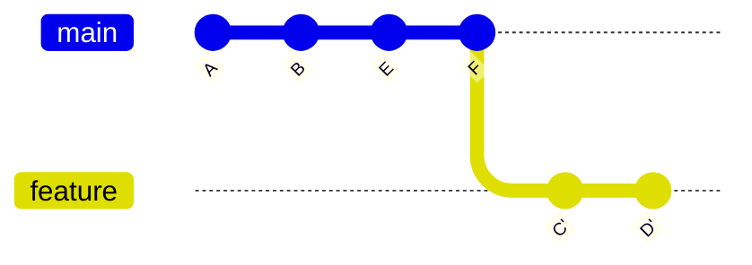

# 3.3 · Rebase

> **Em uma frase:** o rebase "recorta" os commits da sua branch e "cola" eles no final de outra branch, deixando o histórico em uma linha reta, sem commits de merge.

## 🧱 O que é rebase?

Imagine que você criou a branch `feature` a partir da `main`. Enquanto você trabalhava, outras pessoas adicionaram commits na `main`:



Com o **rebase**, o Git pega os seus commits (`C` e `D`) e os reaplica **depois** do último commit da `main`, como se você tivesse começado a branch agora:



Os commits `C'` e `D'` têm o mesmo conteúdo, mas são **commits novos** (com hashes diferentes).

## ⚖️ Merge x Rebase

| | Merge | Rebase |
| --- | --- | --- |
| O que faz | Junta as branches criando um commit de merge | Reaplica seus commits no topo da outra branch |
| Histórico | Mostra exatamente o que aconteceu (com "bifurcações") | Linear, mais limpo de ler |
| Reescreve commits? | Não | **Sim** (cria commits novos) |
| Seguro para branches compartilhadas? | Sim | **Não** |

> [!CAUTION]
> **Regra de ouro do rebase:** nunca faça rebase em commits que **já foram enviados** e que outras pessoas possam estar usando (como a `main` do repositório remoto). Como o rebase cria commits novos, o histórico de quem já tinha os antigos fica bagunçado.

## 🛠️ Como fazer um rebase

O uso mais comum é **atualizar sua branch** com as novidades da `main` antes de fazer o merge:

```bash
# 1. Vá para a SUA branch (a que vai ser "movida")
git switch feature

# 2. Reaplique seus commits no topo da main
git rebase main
```

Depois disso, um merge na `main` vai ser um simples *fast-forward*:

```bash
git switch main
git merge feature
```

## ⚔️ Resolvendo conflitos durante o rebase

O rebase reaplica os commits **um por um**, então pode parar em cada commit que tiver conflito.

```bash
# 1. Resolva o conflito no arquivo e marque como resolvido
git add arquivo-com-conflito.txt

# 2. Continue o rebase (vai para o próximo commit)
git rebase --continue

# Se quiser pular o commit atual (descarta esse commit!)
git rebase --skip

# Se quiser desistir e voltar como estava antes do rebase
git rebase --abort
```

> [!NOTE]
> Diferente do merge, no rebase você **não** faz `git commit` depois de resolver o conflito. Você usa `git rebase --continue`.

## ✨ Rebase interativo

Com o rebase interativo você pode **editar o histórico** dos últimos commits: juntar, reordenar, renomear ou remover commits.

```bash
# Edita os últimos 3 commits
git rebase -i HEAD~3
```

No editor, cada commit aparece com uma palavra na frente. Troque a palavra para escolher o que fazer:

| Palavra | O que faz |
| --- | --- |
| `pick` | Mantém o commit como está |
| `reword` | Mantém, mas permite mudar a mensagem |
| `squash` | Junta com o commit anterior |
| `drop` | Remove o commit |

Veja um exemplo completo de *squash* na aula [2.8](../02-git-basico/08-desfazendo-acoes.md).

## 📌 Resumindo

- Rebase move seus commits para o topo de outra branch, deixando o histórico linear.
- Uso típico: `git switch feature` → `git rebase main`.
- Em conflitos: resolver → `git add` → `git rebase --continue` (ou `--abort` para desistir).
- **Nunca** faça rebase em commits que já foram compartilhados.
- `git rebase -i` permite editar, juntar e remover commits.

## 🏋️ Mão na massa

> Tente resolver antes de abrir a resposta. Os exercícios práticos usam a pasta `treino-git`, criada na aula 1.5.

**1.** Crie uma branch `feature-rebase` com um commit, volte para a `main`, faça outro commit e então faça o rebase da sua branch sobre a `main`. Compare o gráfico antes e depois.

<details>
<summary>Ver resposta</summary>

```bash
git switch -c feature-rebase
echo "c" > c.txt && git add c.txt && git commit -m "Adiciona c.txt"
git switch main
echo "d" > d.txt && git add d.txt && git commit -m "Adiciona d.txt"
git log --graph --oneline --all   # antes: duas linhas separadas

git switch feature-rebase
git rebase main
git log --graph --oneline --all   # depois: uma linha reta
```

</details>

**2.** Por que não devemos fazer rebase da `main` que já está no GitHub e é usada por outras pessoas?

<details>
<summary>Ver resposta</summary>

Porque o rebase **cria commits novos** (com outros hashes) e descarta os antigos. Quem já tinha baixado os commits antigos fica com um histórico diferente do remoto, o que causa conflitos e confusão.

</details>

**3.** Durante um rebase, você resolveu um conflito e deu `git add`. Qual é o próximo comando?

<details>
<summary>Ver resposta</summary>

`git rebase --continue`. (No rebase não se usa `git commit` para concluir.)

</details>

---

<div align="center">

[⬅️ 3.2 Merge](./02-merge.md) &nbsp;|&nbsp; [🏠 Índice](../../README.md) &nbsp;|&nbsp; [3.4 Clone e push ➡️](./04-clone-e-push.md)

</div>
