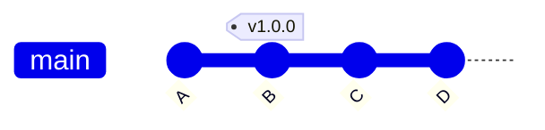

# 3.7 · Trabalhando com tags

> **Em uma frase:** uma tag é uma **etiqueta fixa** que você cola em um commit importante, normalmente para marcar uma versão, como `v1.0.0`.

## 🏷️ Tag x Branch

As duas são "etiquetas" que apontam para um commit, mas com uma diferença fundamental:

| | Branch | Tag |
| --- | --- | --- |
| Se move com novos commits? | ✅ Sim, avança a cada commit | ❌ Não, fica parada para sempre |
| Para que serve | Linha de trabalho em andamento | Marcar um ponto importante (versão) |
| Exemplo | `main`, `feature-login` | `v1.0.0`, `v2.3.1` |

> [!TIP]
> **Analogia:** a branch é o **marcador de página** que você vai avançando enquanto lê o livro. A tag é um **post-it** colado em uma página específica que você quer encontrar depois.



A tag `v1.0.0` fica parada no commit `B` para sempre, enquanto a `main` continua avançando.

### Quando usar?

- Marcar **lançamentos** (*releases*): `v1.0.0`, `v1.1.0`...
- Guardar um ponto de referência para poder **voltar** a ele no futuro.
- No GitHub, as tags são a base da página de **Releases**.

> [!NOTE]
> É comum usar o padrão **[Versionamento Semântico](https://semver.org/lang/pt-BR/)**: `vMAIOR.MENOR.CORREÇÃO`. Ex.: `v2.4.1` → versão maior 2, funcionalidade 4, correção 1.

## 🛠️ Criando tags

Existem dois tipos de tag:

```bash
# Tag LEVE: só um nome apontando para o commit atual
git tag v1.0.0

# Tag ANOTADA (recomendada): guarda autor, data e uma mensagem
git tag -a v1.0.0 -m "Primeira versão estável"

# Criar a tag em um commit específico (não o atual)
git tag -a v0.9.0 <hash-do-commit> -m "Versão beta"
```

> [!TIP]
> Prefira **tags anotadas** (`-a`) para marcar versões. Elas guardam mais informações e são as recomendadas para releases.

## 👀 Consultando tags

```bash
# Lista todas as tags
git tag

# Lista tags que seguem um padrão
git tag -l "v1.*"

# Mostra os detalhes de uma tag e do commit dela
git show v1.0.0
```

## ☁️ Enviando tags para o GitHub

O `git push` comum **não envia tags**. Você precisa enviá-las explicitamente:

```bash
# Envia uma tag específica
git push origin v1.0.0

# Envia todas as tags de uma vez
git push origin --tags
```

## 🗑️ Apagando tags

```bash
# Apaga a tag local
git tag -d v1.0.0

# Apaga a tag no remoto
git push origin --delete v1.0.0
```

## 🔧 Acessando o código de uma versão antiga

```bash
git checkout v1.0.0
```

Seus arquivos voltam a ficar exatamente como estavam naquela versão. Você entra em **"detached HEAD"** (não está em nenhuma branch), então pode olhar e testar, mas commits feitos ali podem se perder.

### Precisa corrigir algo nessa versão?

Crie uma branch a partir da tag:

```bash
git checkout v1.0.0
git switch -c correcao-v1.0.1
```

Agora você está em uma branch normal e pode fazer commits. Depois de corrigir:

1. Volte para a `main`: `git switch main`
2. Traga a correção com `git merge correcao-v1.0.1` (ou use rebase, veja as aulas [3.2](./02-merge.md) e [3.3](./03-rebase.md)).
3. Crie a tag da nova versão: `git tag -a v1.0.1 -m "Corrige bug X"`.

## 📌 Resumindo

| Comando | O que faz |
| --- | --- |
| `git tag -a v1.0.0 -m "msg"` | Cria uma tag anotada no commit atual |
| `git tag` | Lista as tags |
| `git show v1.0.0` | Mostra os detalhes da tag |
| `git push origin --tags` | Envia todas as tags para o remoto |
| `git tag -d v1.0.0` | Apaga uma tag local |
| `git checkout v1.0.0` | Visita o código daquela versão |

## 🏋️ Mão na massa

> Tente resolver antes de abrir a resposta. Os exercícios práticos usam a pasta `treino-git`, criada na aula 1.5.

**1.** No `treino-git`, crie uma tag anotada `v1.0.0` com uma mensagem e veja os detalhes dela.

<details>
<summary>Ver resposta</summary>

```bash
git tag -a v1.0.0 -m "Primeira versão do treino"
git show v1.0.0
```

</details>

**2.** Liste só as tags que começam com `v1`.

<details>
<summary>Ver resposta</summary>

```bash
git tag -l "v1*"
```

</details>

**3.** Crie uma branch `correcao-v1` a partir da tag `v1.0.0`.

<details>
<summary>Ver resposta</summary>

```bash
git switch -c correcao-v1 v1.0.0
```
(É o mesmo que `git checkout v1.0.0` seguido de `git switch -c correcao-v1`.)

</details>

---

<div align="center">

[⬅️ 3.6 Bare repository](./06-bare-repository.md) &nbsp;|&nbsp; [🏠 Índice](../../README.md) &nbsp;|&nbsp; [4.1 Repositório remoto ➡️](../04-git-avancado/01-repositorio-remoto.md)

</div>
