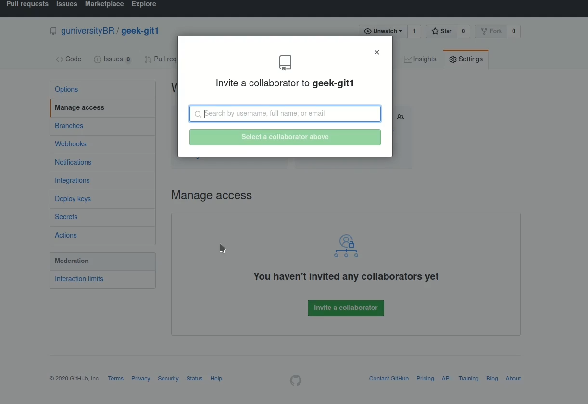

# 4.3 · Adicionando colaboradores no meu projeto

> **Em uma frase:** para que outra pessoa possa enviar código (`push`) diretamente para o seu repositório no GitHub, você precisa convidá-la como **colaboradora**.

## 👥 Passo a passo

1. **Abra o repositório** no GitHub (ex.: `https://github.com/seu-usuario/seu-repositorio`).
2. Clique na aba **⚙️ Settings** (no topo da página do repositório).
3. No menu lateral esquerdo, clique em **Collaborators** (em versões antigas do GitHub essa opção se chamava *Manage access*).
4. O GitHub pode pedir sua senha para confirmar.
5. Clique em **Add people**.
6. Digite o **nome de usuário**, nome completo ou e-mail da pessoa e selecione-a na lista.
7. Clique em **Add ... to this repository** para enviar o convite.
8. A pessoa recebe o convite por **e-mail** e nas **notificações** do GitHub. Ela precisa **aceitar** para virar colaboradora.

### Print da tela de gerenciamento de acesso

## 🔐 E os níveis de permissão?

Depende de quem é o dono do repositório:

| Tipo de repositório | Permissões |
| --- | --- |
| **Conta pessoal** (ex.: `github.com/seu-usuario/...`) | Todo colaborador recebe acesso de **escrita**: pode ler, criar branches e fazer push. Só o dono gerencia as configurações. |
| **Organização** (ex.: `github.com/minha-empresa/...`) | Você escolhe o papel: **Read**, **Triage**, **Write**, **Maintain** ou **Admin**. |

Papéis em organizações, do menor para o maior acesso:

| Papel | O que permite |
| --- | --- |
| **Read** | Ver e clonar o código, abrir issues e comentar |
| **Triage** | Read + organizar issues e pull requests (labels, atribuições) |
| **Write** | Triage + enviar código (push) e aceitar pull requests |
| **Maintain** | Write + gerenciar algumas configurações do repositório |
| **Admin** | Acesso total, inclusive adicionar pessoas e apagar o repositório |

> [!WARNING]
> Colaboradores com acesso de escrita podem alterar **qualquer coisa** no código. Só convide pessoas de confiança e combine as regras do projeto (por exemplo, "ninguém faz push direto na `main`; tudo passa por pull request").

> [!TIP]
> Para projetos **open source**, normalmente você **não** adiciona colaboradores. Qualquer pessoa pode contribuir fazendo um **fork** e enviando um **pull request** (veja o [Módulo 5](../05-open-source/02-fork.md)).

## 📌 Resumindo

- Caminho: **Settings → Collaborators → Add people**.
- A pessoa precisa **aceitar** o convite.
- Em repositórios pessoais, colaboradores têm acesso de escrita; em organizações, você escolhe o papel.
- Convide apenas pessoas de confiança.

---

[⬅️ 4.2 Clone e pull](./02-clone-e-pull.md) &nbsp;|&nbsp; [🏠 Índice](../../README.md) &nbsp;|&nbsp; [4.4 Histórico de commits ➡️](./04-historico-de-commits.md)

