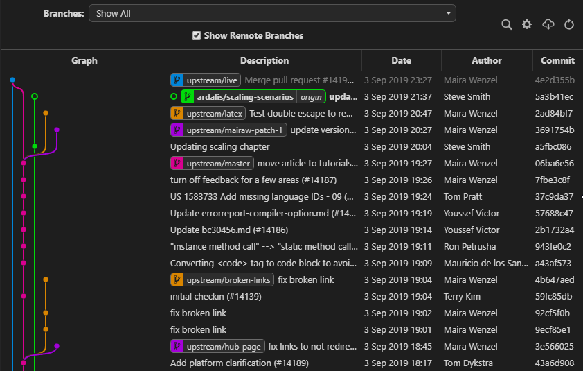

# 4.4 · Consultando o histórico de commits

> **Em uma frase:** você pode ver o histórico do projeto de três jeitos: pelo **terminal** (`git log`), por **interfaces gráficas** no editor ou pela **página do GitHub**.

## 💻 1. Pelo terminal

O `git log` e seus filtros (`--oneline`, `--author`, `--since`, `--grep`...) foram vistos na aula [2.5 Como consultar o histórico](../02-git-basico/05-historico-do-projeto.md). Dois comandos complementam o que você já sabe:

```bash
# Histórico de um arquivo específico
git log --oneline -- caminho/do/arquivo.txt

# Quem alterou cada linha de um arquivo (e em qual commit)
git blame caminho/do/arquivo.txt
```

## 🖼️ 2. Por interfaces gráficas

Muitas ferramentas desenham o histórico como um **gráfico colorido**, onde cada linha vertical é uma branch e cada bolinha é um commit. Fica muito mais fácil enxergar quando as branches foram criadas e mescladas.



Algumas opções populares:

- Extensões do VS Code como **Git Graph**, **GitLens** e **Git History** (veja a [aula 6.1](../06-curriculo-online/01-curriculo-e-plugins.md));
- **GitHub Desktop**, **GitKraken**, **Sourcetree**;
- No próprio terminal: `git log --graph --oneline --all`.

## 🌐 3. Pela página do GitHub

No GitHub (e também no GitLab e no Bitbucket), dá para navegar pelo histórico direto no navegador:

1. Abra o repositório.
2. Clique no link de **commits** (ícone de relógio 🕒, perto do botão "Code").
3. Clique em qualquer commit para ver **exatamente** quais linhas foram adicionadas (verde) e removidas (vermelho).

> [!TIP]
> Dentro de um arquivo no GitHub, o botão **History** mostra só os commits que mexeram naquele arquivo, e o botão **Blame** mostra quem alterou cada linha.

## 📌 Resumindo

- **Terminal:** `git log -- arquivo` (histórico de um arquivo) e `git blame` (autor de cada linha).
- **Interfaces gráficas:** visualização em gráfico das branches e commits.
- **GitHub:** aba de commits, com o "diff" colorido de cada alteração.

## 🏋️ Mão na massa

> Tente resolver antes de abrir a resposta. Os exercícios práticos usam a pasta `treino-git`, criada na aula 1.5.

**1.** Veja todos os commits que alteraram o arquivo `README.md` do `treino-git`.

<details>
<summary>Ver resposta</summary>

```bash
git log --oneline -- README.md
```

</details>

**2.** Descubra quem alterou cada linha do `README.md` e em qual commit.

<details>
<summary>Ver resposta</summary>

```bash
git blame README.md
```

</details>

**3.** No GitHub, abra o histórico do seu `treino-git` e encontre a alteração que você fez pelo site na aula anterior. Quais cores indicam linhas adicionadas e removidas?

<details>
<summary>Ver resposta</summary>

Clique no link de commits (ícone de relógio 🕒) e depois no commit desejado. Linhas **verdes** foram adicionadas e linhas **vermelhas** foram removidas.

</details>

---

<div align="center">

[⬅️ 4.3 Colaboradores](./03-colaboradores.md) &nbsp;|&nbsp; [🏠 Índice](../../README.md) &nbsp;|&nbsp; [4.5 Desfazendo com checkout ➡️](./05-desfazendo-com-checkout.md)

</div>
