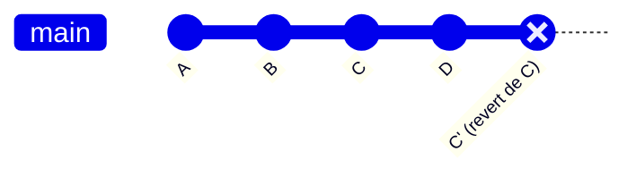

# 4.6 · Desfazendo ações com revert e reset

> **Em uma frase:** o `git revert` desfaz um commit **criando um novo commit** (seguro, mantém o histórico); o `git reset` **volta a branch no tempo** e tira commits do histórico (mais drástico).

## 🔁 `git revert`: o "Ctrl+Z" seguro

```bash
git revert <hash-do-commit>
```

O Git cria um **novo commit** que faz exatamente o contrário do commit indicado. Se o commit original adicionou uma linha, o revert remove essa linha.



- ✅ Nada é apagado: o histórico mostra o erro **e** a correção.
- ✅ Seguro para commits que **já foram enviados** ao GitHub.
- O Git abre o editor com a mensagem `Revert "..."`; basta salvar e fechar.

## ⏪ `git reset`: voltando a branch no tempo

```bash
git reset <hash-do-commit>
```

A branch passa a apontar para o commit indicado. Os commits que vinham **depois** dele saem do histórico.

**Antes:**


**Depois de `git reset B`** (`C` e `D` saem do histórico da branch):


### Voltando N commits sem precisar do hash

```bash
# Formato
git reset HEAD~<quantidade>

# Exemplo: desfaz os 2 últimos commits
git reset HEAD~2
```

`HEAD~2` quer dizer "dois commits antes do atual".

## 🎚️ Os três modos do reset

O que muda entre eles é **para onde vão as alterações** dos commits desfeitos:

### `--soft`: as alterações voltam para o **staging**

```bash
git reset --soft <hash>
```

Os commits são desfeitos, mas as alterações continuam **preparadas** (como se você tivesse acabado de dar `git add`). Ótimo para **refazer um commit** com outra mensagem ou juntar vários commits em um.

### `--mixed` (padrão): as alterações voltam para os **arquivos**

```bash
git reset --mixed <hash>
# ou simplesmente
git reset <hash>
```

Os commits são desfeitos e as alterações ficam nos arquivos como **modificadas**, mas **fora do staging**. Você pode revisar, escolher o que quer com `git add` e commitar de novo.

### `--hard`: as alterações são **apagadas**

```bash
git reset --hard <hash>
```

Os commits são desfeitos e **todas as alterações são descartadas**: do staging e da pasta. O projeto fica idêntico ao commit indicado.

> [!CAUTION]
> O `--hard` também apaga qualquer alteração **não commitada** que você tenha no momento. Não existe "desfazer" fácil para isso. Use com muito cuidado.

### Resumo visual

| Modo | Commits | Staging | Arquivos na pasta |
| --- | --- | --- | --- |
| `--soft` | Desfeitos | ✅ Alterações ficam aqui | Mantidos |
| `--mixed` | Desfeitos | Limpo | ✅ Alterações ficam aqui |
| `--hard` | Desfeitos | Limpo | ❌ Alterações apagadas |

## ⚖️ Revert ou reset?

| | `git revert` | `git reset` |
| --- | --- | --- |
| Como desfaz | Cria um commit novo "ao contrário" | Remove commits do histórico |
| Histórico | Preservado | Reescrito |
| Commits já enviados ao GitHub | ✅ Use este | ❌ Evite |
| Commits só locais | Funciona | ✅ Ideal |

> [!TIP]
> **Regra prática:** se o commit **já foi para o GitHub**, use **revert**. Se ainda está **só no seu computador**, pode usar **reset**.

> [!NOTE]
> Fez um `reset` e se arrependeu? O comando `git reflog` mostra tudo por onde o `HEAD` passou, inclusive os commits "removidos". Com o hash em mãos, `git reset --hard <hash>` traz tudo de volta (desde que eles tenham sido commitados um dia).

## 📌 Resumindo

- `git revert <hash>`: desfaz criando um novo commit. Seguro para o que já foi compartilhado.
- `git reset <hash>`: volta a branch e remove commits do histórico.
  - `--soft` → alterações no staging;
  - `--mixed` (padrão) → alterações nos arquivos;
  - `--hard` → alterações apagadas.
- `HEAD~N` volta N commits sem precisar do hash.

## 🏋️ Mão na massa

> Tente resolver antes de abrir a resposta. Os exercícios práticos usam a pasta `treino-git`, criada na aula 1.5.

**1.** Faça um commit com um "erro" proposital e desfaça-o com `revert`. O commit original some do `git log`?

<details>
<summary>Ver resposta</summary>

```bash
echo "erro" >> README.md && git commit -am "Commit com erro"
git revert HEAD
git log --oneline
```
**Não some.** O log mostra o commit com erro **e** um novo commit `Revert "Commit com erro"`.

</details>

**2.** Faça dois commits e depois rode `git reset --soft HEAD~2`. O que o `git status` mostra?

<details>
<summary>Ver resposta</summary>

As alterações dos dois commits aparecem como **prontas para commit** (*Changes to be committed*), porque o `--soft` devolve tudo para o staging.

</details>

**3.** Você rodou `git reset --hard` e perdeu um commit que precisava. Ainda dá para recuperar?

<details>
<summary>Ver resposta</summary>

Sim, se ele foi commitado. Use o `reflog` para encontrar o hash e volte para ele:
```bash
git reflog
git reset --hard <hash-do-commit-perdido>
```

</details>

---

<div align="center">

[⬅️ 4.5 Desfazendo com checkout](./05-desfazendo-com-checkout.md) &nbsp;|&nbsp; [🏠 Índice](../../README.md) &nbsp;|&nbsp; [4.7 Resolvendo conflitos ➡️](./07-conflitos.md)

</div>
