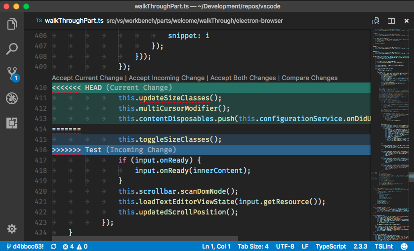

# 4.7 · Resolvendo conflitos

> **Em uma frase:** um conflito acontece quando duas pessoas (ou duas branches) alteram **a mesma linha** do mesmo arquivo, e o Git precisa que **você** decida qual versão fica.

## 😱 Calma, conflito não é erro

Conflito é normal e acontece com todo mundo. O Git consegue juntar alterações sozinho na maioria das vezes, mas quando as duas versões mexem **no mesmo trecho**, ele não tem como adivinhar qual está certa. Então ele para e pede ajuda.

Conflitos costumam aparecer em:

- `git merge`
- `git pull` (porque ele faz um merge)
- `git rebase`
- `git cherry-pick`

## 🔍 Como um conflito aparece

O terminal mostra algo assim:

```text
Auto-merging index.html
CONFLICT (content): Merge conflict in index.html
Automatic merge failed; fix conflicts and then commit the result.
```

E dentro do arquivo, o Git marca o trecho em conflito:

```text
<<<<<<< HEAD
<h1>Bem-vindo ao meu site</h1>
=======
<h1>Olá, seja bem-vindo!</h1>
>>>>>>> feature-titulo
```

| Marcador | Significado |
| --- | --- |
| `<<<<<<< HEAD` | Início da **sua** versão (a branch em que você está) |
| `=======` | Divisória entre as duas versões |
| `>>>>>>> feature-titulo` | Fim da versão que está **chegando** (da outra branch) |

### Exemplo visual no editor



> [!TIP]
> O **VS Code** destaca os conflitos e mostra botões como **Accept Current Change** (manter a sua), **Accept Incoming Change** (manter a que chegou) e **Accept Both Changes** (manter as duas). Isso facilita muito!

## 🛠️ Resolvendo, passo a passo

1. **Veja quais arquivos têm conflito:**

   ```bash
   git status
   # Os arquivos aparecem em "Unmerged paths" / "both modified"
   ```

2. **Abra cada arquivo** e procure os marcadores `<<<<<<<`, `=======` e `>>>>>>>`.

3. **Edite o trecho** deixando o código do jeito que deve ficar. Você pode manter uma das versões, a outra ou uma combinação das duas.

4. **Apague os marcadores** (`<<<<<<<`, `=======`, `>>>>>>>`). O arquivo final fica, por exemplo:

   ```html
   <h1>Olá, seja bem-vindo ao meu site!</h1>
   ```

5. **Salve o arquivo** e marque o conflito como resolvido:

   ```bash
   git add index.html
   ```

6. **Finalize** depois de resolver todos os arquivos:

   ```bash
   git commit              # se estava fazendo merge ou pull
   git rebase --continue   # se estava fazendo rebase
   ```

### Quer desistir?

```bash
git merge --abort    # cancela o merge e volta como estava antes
git rebase --abort   # cancela o rebase
```

> [!IMPORTANT]
> Depois de resolver, **teste o código** antes de seguir. Um conflito mal resolvido pode deixar o projeto quebrado mesmo que o Git não reclame de nada.

## 🛡️ Como evitar conflitos

- Faça `git pull` com frequência para trabalhar sempre na versão mais recente.
- Faça commits pequenos e frequentes.
- Combine com o time quem está mexendo em quê.
- Evite alterações enormes que mexem no projeto inteiro (como reformatar todos os arquivos) sem avisar.

## 📌 Resumindo

- Conflito = duas alterações na mesma linha; o Git precisa da sua decisão.
- O trecho fica entre `<<<<<<<`, `=======` e `>>>>>>>`.
- Edite → apague os marcadores → `git add` → `git commit` (ou `git rebase --continue`).
- Para desistir: `git merge --abort` ou `git rebase --abort`.

---

<div align="center">

[⬅️ 4.6 Revert e reset](./06-revert-e-reset.md) &nbsp;|&nbsp; [🏠 Índice](../../README.md) &nbsp;|&nbsp; [5.1 Issues ➡️](../05-open-source/01-issues.md)

</div>
