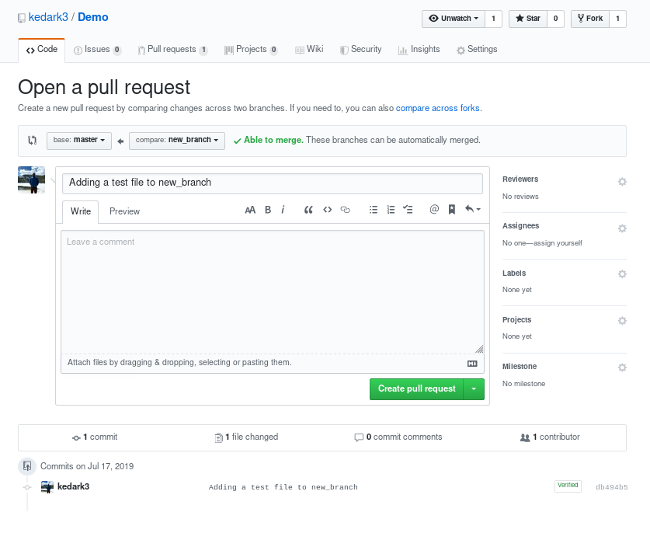

# 5.3 · Realizando e aceitando pull requests

> **Em uma frase:** um *pull request* (PR) é um **pedido** para que as alterações de uma branch (sua ou do seu fork) sejam revisadas e incorporadas ao projeto.



## 📨 O que é um pull request?

O nome confunde um pouco: você está pedindo para o dono do projeto **"puxar" (pull)** as suas alterações para dentro do repositório dele.

O PR é muito mais que um botão de "juntar código". Ele é um **espaço de conversa**, onde:

- você explica **o que** mudou e **por quê**;
- outras pessoas **revisam** o código, comentam linhas específicas e sugerem melhorias;
- testes automáticos podem rodar para garantir que nada quebrou;
- no final, alguém com permissão **aprova e faz o merge**.

> [!NOTE]
> PRs são usados tanto em projetos **open source** (vindo de forks) quanto **dentro de equipes** (de uma branch para a `main` no mesmo repositório).

## 📤 Parte 1: Enviando um pull request

### 1. Faça o fork e clone

Veja o passo a passo na [aula anterior](./02-fork.md).

### 2. Crie uma branch e faça suas alterações

```bash
git switch -c corrige-typo-readme
# ... edite os arquivos ...
git add .
git commit -m "Corrige erro de digitação no README"
```

### 3. Envie a branch para o seu fork

```bash
git push -u origin corrige-typo-readme
```

### 4. Abra o pull request no GitHub

1. Acesse o seu fork no GitHub. Vai aparecer um aviso amarelo com o botão **Compare & pull request**. Clique nele.
2. Confira se a direção está certa: **do seu fork/branch → para o repositório original/main**.
3. Escreva um **título claro** e uma **descrição** explicando:
   - o que foi alterado;
   - por que essa alteração é útil;
   - como testar;
   - se resolve alguma issue (`Closes #12`, por exemplo).
4. Clique em **Create pull request**.

### 5. Acompanhe a revisão

Os mantenedores podem aprovar, comentar ou **pedir alterações**. Se pedirem ajustes, não precisa abrir outro PR: faça novos commits **na mesma branch** e dê `git push`. O PR é atualizado automaticamente.

> [!TIP]
> PRs **pequenos e focados** (um assunto por PR) são revisados e aceitos muito mais rápido do que PRs gigantes.

## ✅ Parte 2: Revisando e aceitando um pull request

Quando alguém envia um PR para o **seu** projeto:

1. **Leia a descrição** e entenda o objetivo da mudança.
2. **Revise o código** na aba **Files changed**. Você pode comentar em linhas específicas.
3. **Teste localmente** antes de aceitar (veja abaixo como fazer).
4. **Dê feedback**: use **Review changes** para *Comment* (comentar), *Approve* (aprovar) ou *Request changes* (pedir alterações). Seja gentil e construtivo!
5. **Faça o merge**: com tudo certo, clique em **Merge pull request** → **Confirm merge**.

### 🧪 Boa prática: testar o PR na sua máquina

Você pode baixar o código de qualquer PR para uma branch local, sem precisar adicionar o fork da pessoa como remoto:

```bash
# Formato
git fetch origin pull/<NÚMERO-DO-PR>/head:<nome-da-branch-local>

# Exemplo: baixa o PR #3 para a branch "testando-pr-3"
git fetch origin pull/3/head:testando-pr-3

# Vá para a branch e teste à vontade
git switch testando-pr-3
```

> [!NOTE]
> O número do PR aparece no título dele no GitHub (ex.: *"Corrige typo #3"*) e na URL (`.../pull/3`).

Depois de testar e aprovar, volte ao GitHub e faça o merge pela interface. Em seguida, atualize sua `main` local com `git switch main` + `git pull`.

## 📌 Resumindo

- Pull request = pedido para incorporar as alterações de uma branch ao projeto.
- **Enviar:** fork → branch → commit → `push` → **Compare & pull request**.
- Ajustes pedidos? Novos commits na mesma branch atualizam o PR.
- **Aceitar:** revisar → testar (`git fetch origin pull/N/head:branch`) → dar feedback → **Merge pull request**.

## 🏋️ Mão na massa

> Tente resolver antes de abrir a resposta. Os exercícios práticos usam a pasta `treino-git`, criada na aula 1.5.

**1.** No seu `treino-git`, crie uma branch, faça um commit, envie para o GitHub, abra um pull request para a `main` e faça o merge você mesmo.

<details>
<summary>Ver resposta</summary>

```bash
git switch -c melhora-readme
echo "Mais uma linha" >> README.md && git commit -am "Melhora o README"
git push -u origin melhora-readme
```
No GitHub: **Compare & pull request → Create pull request → Merge pull request → Confirm merge**. Depois, no computador: `git switch main` e `git pull`.

</details>

**2.** Como baixar o pull request número 5 para uma branch local chamada `revisao-pr-5`?

<details>
<summary>Ver resposta</summary>

```bash
git fetch origin pull/5/head:revisao-pr-5
git switch revisao-pr-5
```

</details>

**3.** O revisor pediu um ajuste no seu PR. Você precisa abrir um pull request novo?

<details>
<summary>Ver resposta</summary>

**Não.** Faça novos commits **na mesma branch** e dê `git push`. O PR é atualizado automaticamente.

</details>

---

<div align="center">

[⬅️ 5.2 Fork](./02-fork.md) &nbsp;|&nbsp; [🏠 Índice](../../README.md) &nbsp;|&nbsp; [6.1 Currículo online e plugins ➡️](../06-curriculo-online/01-curriculo-e-plugins.md)

</div>
