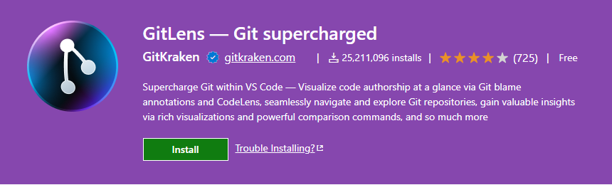
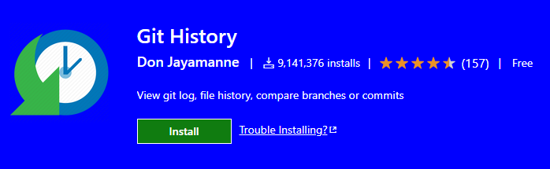

# 6.1 · Currículo online + plugins do Git para o VS Code

> **Em uma frase:** nesta parte do curso colocamos em prática tudo o que vimos, criando um currículo online hospedado de graça no **GitHub Pages**, e conhecemos duas extensões que facilitam usar o Git no VS Code.

## 🔗 Links úteis

| Link | Descrição |
| --- | --- |
| [Projeto de currículo original](https://github.com/felicityBR/felicitybr.github.io) | Repositório usado como base no curso |
| [Meu currículo online](https://github.com/Joshpcbrrj/Joshpcbrrj.github.io) | A minha versão do projeto |
| [GitLens](https://marketplace.visualstudio.com/items?itemName=eamodio.gitlens) | Extensão do VS Code |
| [Git History](https://marketplace.visualstudio.com/items?itemName=donjayamanne.githistory) | Extensão do VS Code |

## 🌐 O projeto: currículo no GitHub Pages

O **GitHub Pages** hospeda sites estáticos (HTML, CSS e JavaScript) **de graça**, direto de um repositório.

O "truque" do projeto é o **nome do repositório**: se ele se chamar exatamente **`seu-usuario.github.io`**, o GitHub publica o site no endereço:

```text
https://seu-usuario.github.io
```

### Resumo do fluxo usado no projeto

1. Fazer um **fork** (ou copiar) do projeto de currículo original.
2. Renomear o repositório para `seu-usuario.github.io` (em **Settings → General → Repository name**).
3. **Clonar** o repositório para o computador.
4. Editar o HTML com as suas informações.
5. Fazer `git add`, `git commit` e `git push`.
6. Esperar alguns minutos e acessar `https://seu-usuario.github.io`. 🎉

> [!TIP]
> Se o site não aparecer, confira em **Settings → Pages** se a publicação está ativada a partir da branch `main`.

## 🔦 Extensão GitLens



O **GitLens** mostra as informações do Git **dentro do código**, enquanto você trabalha. Os recursos mais úteis para quem está começando:

| Recurso | O que faz |
| --- | --- |
| **Blame em linha** | Mostra, ao lado de cada linha, quem a alterou por último, quando e em qual commit. |
| **Histórico do arquivo** | Lista todos os commits que mexeram no arquivo aberto. |
| **Comparação de versões** | Mostra as diferenças entre versões do arquivo, linha a linha. |
| **Visualização de branches** | Ajuda a explorar branches, commits e tags de forma visual. |
| **Pesquisa** | Encontra commits por mensagem, autor ou arquivo. |
| **Integração com GitHub** | Mostra informações de pull requests e issues no editor. |

> [!NOTE]
> O GitLens tem uma versão gratuita bem completa e alguns recursos pagos (GitLens Pro). Tudo o que está na tabela acima funciona na versão gratuita.

## 📈 Extensão Git History



O **Git History** foca em uma coisa: mostrar o **histórico de commits** de forma visual.

| Recurso | O que faz |
| --- | --- |
| **Gráfico de commits** | Desenha as branches e merges em um gráfico interativo. |
| **Detalhes do commit** | Ao clicar em um commit, mostra mensagem, autor, data e arquivos alterados. |
| **Comparação** | Compara um arquivo entre dois commits diferentes. |
| **Busca e filtros** | Encontra commits por mensagem, autor ou branch. |
| **Histórico de arquivo/linha** | Mostra só o histórico de um arquivo ou de uma linha específica. |

> [!TIP]
> Depois de instalar, abra a paleta de comandos (`Ctrl+Shift+P` / `Cmd+Shift+P`) e digite **"Git: View History"** para abrir o histórico.

## 📌 Resumindo

- Um repositório chamado `seu-usuario.github.io` vira um site gratuito no **GitHub Pages**.
- **GitLens**: informações do Git direto no código (quem alterou cada linha, histórico, comparações).
- **Git History**: gráfico interativo do histórico de commits.

---

<div align="center">

[⬅️ 5.3 Pull requests](../05-open-source/03-pull-requests.md) &nbsp;|&nbsp; [🏠 Índice](../../README.md) &nbsp;|&nbsp; [7.1 Markdown ➡️](../07-markdown-e-gist/01-markdown.md)

</div>
