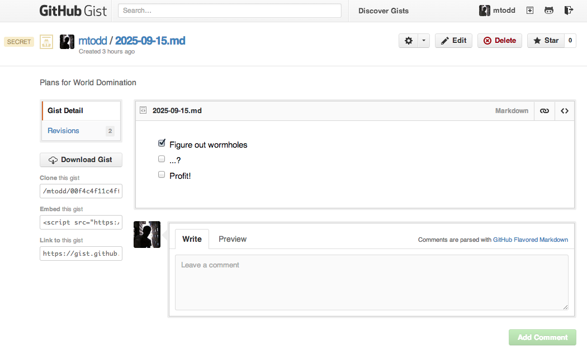
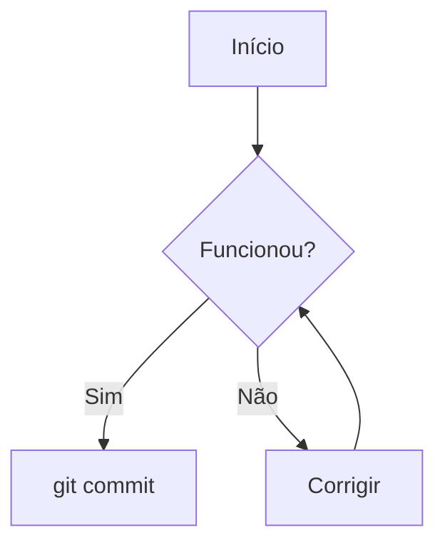

# 7.1 · Entendendo o Markdown

> **Em uma frase:** Markdown é um jeito simples de formatar texto usando símbolos comuns (`#`, `*`, `-`...). É a linguagem dos arquivos `README.md` do GitHub, e este material inteiro foi escrito com ela.

## 🔗 Links úteis

- [Guia oficial do GitHub: sintaxe básica de escrita e formatação](https://docs.github.com/pt/get-started/writing-on-github/getting-started-with-writing-and-formatting-on-github/basic-writing-and-formatting-syntax)
- [DevDocs: Markdown](https://devdocs.io/markdown/)
- [Guia rápido de Markdown (GitLab)](https://ajuda.gitlab.io/guia-rapido/markdown/markdown/)
- [Guia básico de Markdown (Pipz)](https://docs.pipz.com/central-de-ajuda/learning-center/guia-basico-de-markdown#open)
- [Markdown: parte 1 (Inteligência Urbana)](https://www.inteligenciaurbana.org/2021/04/markdown-parte1.html)
- [Extensão Markdown Preview Enhanced para VS Code](https://marketplace.visualstudio.com/items?itemName=shd101wyy.markdown-preview-enhanced)
- [📄 Modelo de README pronto para usar](./modelo-readme/modelo-de-readme.md)

## 🤔 O que é Markdown?

Markdown é uma **linguagem de marcação leve**. Em vez de clicar em botões de "negrito" ou "título" como no Word, você usa símbolos no próprio texto, e uma ferramenta (como o GitHub) transforma isso em texto formatado.

- É **fácil de ler** mesmo sem estar formatado.
- É usado no **GitHub**, GitLab, Reddit, Stack Overflow, Discord, Notion, Obsidian e muitos outros.
- A extensão dos arquivos é **`.md`** (como o famoso `README.md`).

> [!TIP]
> No **VS Code**, abra um arquivo `.md` e aperte `Ctrl+Shift+V` (ou `Cmd+Shift+V` no Mac) para ver a pré-visualização. Com `Ctrl+K` e depois `V`, ela abre lado a lado com o código.

---

## 📝 Sintaxe básica

Em cada item abaixo você vê **o que escrever** e **como fica** no GitHub.

### Títulos (cabeçalhos)

Use de 1 a 6 `#` seguidos de um **espaço**. Quanto mais `#`, menor o título.

```markdown
# Título 1
## Título 2
### Título 3
#### Título 4
##### Título 5
###### Título 6
```

> [!TIP]
> Use só **um** `# Título 1` por arquivo (o título principal) e organize o resto com `##` e `###`.

### Parágrafos e quebras de linha

```markdown
Este é um parágrafo.

Este é outro parágrafo (deixei uma linha em branco entre eles).

Esta linha termina com uma barra invertida\
e por isso esta continua logo abaixo, no mesmo parágrafo.
```

**Resultado:**

Este é um parágrafo.

Este é outro parágrafo (deixei uma linha em branco entre eles).

Esta linha termina com uma barra invertida\
e por isso esta continua logo abaixo, no mesmo parágrafo.

> [!NOTE]
> Só apertar Enter **não** quebra a linha em Markdown. Para quebrar, termine a linha com `\`, com **dois espaços** ou use a tag HTML `<br>`.

### Estilos de texto

| Você escreve | Resultado |
| --- | --- |
| `**negrito**` ou `__negrito__` | **negrito** |
| `*itálico*` ou `_itálico_` | *itálico* |
| `***negrito e itálico***` | ***negrito e itálico*** |
| `~~riscado~~` | ~~riscado~~ |
| `` `código` `` | `código` |
| `<sub>subscrito</sub>` | H<sub>2</sub>O |
| `<sup>sobrescrito</sup>` | x<sup>2</sup> |

### Listas

**Não ordenada** (use `-`, `*` ou `+`):

```markdown
- Item 1
- Item 2
  - Subitem (2 espaços de recuo)
  - Outro subitem
- Item 3
```

- Item 1
- Item 2
  - Subitem (2 espaços de recuo)
  - Outro subitem
- Item 3

**Ordenada** (números seguidos de ponto):

```markdown
1. Primeiro
2. Segundo
3. Terceiro
```

1. Primeiro
2. Segundo
3. Terceiro

### Lista de tarefas (checkbox)

```markdown
- [x] Tarefa concluída
- [ ] Tarefa pendente
- [ ] ~~Tarefa cancelada~~
```

- [x] Tarefa concluída
- [ ] Tarefa pendente
- [ ] ~~Tarefa cancelada~~

### Links

```markdown
[Texto do link](https://github.com)

[Link com dica ao passar o mouse](https://github.com "Abrir o GitHub")

<https://github.com>

[Link para outro arquivo do repositório](./7.2%20-%20Entendendo%20Gists.md)

[Link para um título desta página](#tabelas)
```

**Resultado:**

[Texto do link](https://github.com) · [Link com dica ao passar o mouse](https://github.com "Abrir o GitHub") · <https://github.com> · [Link para outro arquivo](./02-gists.md) · [Link para um título desta página](#tabelas)

> [!TIP]
> Em links para arquivos com espaços no nome, troque cada espaço por `%20`.
> Para links para títulos, use o texto do título em minúsculas, com `-` no lugar dos espaços e sem pontuação.

> [!NOTE]
> O GitHub **não permite** abrir links em nova aba (o `target="_blank"` do HTML é ignorado por segurança).

### Links por referência

Útil quando o mesmo link aparece várias vezes ou para deixar o texto mais limpo:

```markdown
Assista no [YouTube][yt] ou leia a [documentação][docs].

[yt]: https://www.youtube.com
[docs]: https://docs.github.com
```

Assista no [YouTube][yt] ou leia a [documentação][docs].

[yt]: https://www.youtube.com
[docs]: https://docs.github.com

### Imagens

É igual ao link, mas com um `!` na frente. O texto entre colchetes é o **texto alternativo** (lido por leitores de tela e exibido se a imagem não carregar).

```markdown



```

Para **controlar o tamanho**, use HTML:

```html

```


### Citações

```markdown
> Esta é uma citação.
>
>> Esta é uma citação dentro da citação.
```

> Esta é uma citação.
>
>> Esta é uma citação dentro da citação.

### Código

**Em linha:** use uma crase de cada lado.

```markdown
Rode o comando `git status` para ver o status.
```

Rode o comando `git status` para ver o status.

**Em bloco:** use três crases antes e depois. Coloque o nome da linguagem logo após as crases de abertura para ter **cores** (syntax highlighting).

````markdown
```python
def saudacao(nome):
    print(f"Olá, {nome}!")
```
````

```python
def saudacao(nome):
    print(f"Olá, {nome}!")
```

> [!TIP]
> Algumas linguagens aceitas: `bash`, `python`, `javascript`, `html`, `css`, `json`, `java`, `csharp`, `sql`, `diff`.

### Linha horizontal

Qualquer uma destas, sozinha em uma linha:

```markdown
---
***
___
```

---

### Tabelas

```markdown
| Produto       | Preço       |
| ------------- | ----------- |
| Playstation 4 | R$ 1.799,54 |
| Xbox One      | R$ 1.789,00 |
```

| Produto       | Preço       |
| ------------- | ----------- |
| Playstation 4 | R$ 1.799,54 |
| Xbox One      | R$ 1.789,00 |

**Alinhamento** com `:` na linha de separação:

```markdown
| Esquerda | Centro | Direita |
| :------- | :----: | ------: |
| Atari    | 1977   | R$ 199  |
| Fósforo  | 1826   | R$ 0,30 |
```

| Esquerda | Centro | Direita |
| :------- | :----: | ------: |
| Atari    | 1977   | R$ 199  |
| Fósforo  | 1826   | R$ 0,30 |

> [!NOTE]
> As colunas não precisam ficar alinhadas no texto; o `|` é o que importa. Alinhar só deixa o arquivo mais fácil de ler.

### Escapando caracteres

Quer mostrar um `*` ou `#` sem que ele vire formatação? Coloque uma barra invertida `\` antes:

```markdown
\*isto não fica em itálico\*
```

\*isto não fica em itálico\*

---

## 🐙 Recursos extras do GitHub

Os recursos abaixo funcionam no **GitHub**, mas podem não funcionar em outros lugares.

### Alertas (caixas de destaque)

```markdown
> [!NOTE]
> Informação útil.

> [!TIP]
> Uma dica para fazer melhor.

> [!IMPORTANT]
> Algo essencial para entender.

> [!WARNING]
> Atenção: possível problema.

> [!CAUTION]
> Cuidado: risco de consequências negativas.
```

> [!NOTE]
> Informação útil.

> [!TIP]
> Uma dica para fazer melhor.

> [!IMPORTANT]
> Algo essencial para entender.

> [!WARNING]
> Atenção: possível problema.

> [!CAUTION]
> Cuidado: risco de consequências negativas.

### Seção recolhível (sanfona)

```html
<details>
<summary>Clique para expandir</summary>

Conteúdo escondido. Aqui dentro você pode usar **Markdown** normalmente.

</details>
```

<details>
<summary>Clique para expandir</summary>

Conteúdo escondido. Aqui dentro você pode usar **Markdown** normalmente.

</details>

> [!TIP]
> Deixe uma **linha em branco** depois do `</summary>` para o Markdown dentro do bloco funcionar.

### Emojis

```markdown
:rocket: :tada: :bug: :white_check_mark:
```

:rocket: :tada: :bug: :white_check_mark:

Você também pode colar o emoji direto: 🚀 🎉 🐞 ✅. Lista completa de códigos: [Emoji Cheat Sheet](https://github.com/ikatyang/emoji-cheat-sheet).

### Notas de rodapé

```markdown
O Git foi criado em 2005[^1].

[^1]: Por Linus Torvalds, criador do Linux.
```

O Git foi criado em 2005[^1].

[^1]: Por Linus Torvalds, criador do Linux.

(A nota aparece no final da página.)

### Mencionar pessoas, issues e commits

```markdown
@usuario       → menciona e notifica uma pessoa
#42            → link para a issue ou PR número 42
a1b2c3d        → link para um commit (pelo hash)
```

### Diagramas com Mermaid

Use um bloco de código com a linguagem `mermaid`:

````markdown

````


### Fórmulas matemáticas (LaTeX)

```markdown
Em linha: $\sqrt{9} = 3$

Em bloco:

$$
ax^2 + bx + c = 0
$$
```

Em linha: $\sqrt{9} = 3$

Em bloco:

$$
ax^2 + bx + c = 0
$$

### Comentários (texto invisível)

```html
<!-- Este texto não aparece na página -->
```

### Cores no texto?

> [!WARNING]
> O GitHub **remove** estilos como `<span style="color:red">`, então **não dá para colorir texto** em um README. Em outros visualizadores (como a pré-visualização do VS Code) pode funcionar. No GitHub, use **negrito**, alertas ou emojis para chamar atenção.

---

## 📌 Resumindo

| Elemento | Sintaxe |
| --- | --- |
| Título | `# Título` |
| Negrito / itálico | `**negrito**` / `*itálico*` |
| Lista | `- item` ou `1. item` |
| Tarefa | `- [ ] tarefa` |
| Link | `[texto](url)` |
| Imagem | `` |
| Código | `` `código` `` ou bloco com três crases |
| Citação | `> texto` |
| Tabela | `\| A \| B \|` + `\| --- \| --- \|` |
| Alerta (GitHub) | `> [!NOTE]` |
| Seção recolhível | `<details><summary>...</summary>...</details>` |

---

<div align="center">

[⬅️ 6.1 Currículo online e plugins](../06-curriculo-online/01-curriculo-e-plugins.md) &nbsp;|&nbsp; [🏠 Índice](../../README.md) &nbsp;|&nbsp; [7.2 Gists ➡️](./02-gists.md)

</div>
