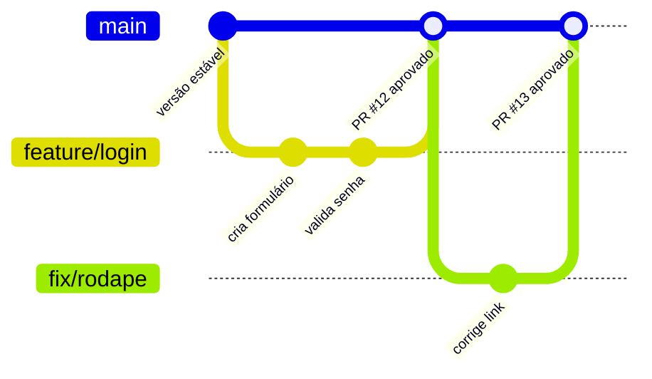

# 8.3 · Trabalhando em equipe com o GitHub Flow

> **Em uma frase:** o GitHub Flow é um "combinado" simples para times: a `main` está sempre funcionando, e toda mudança nasce em uma branch, passa por um pull request e só então entra na `main`.

> [!NOTE]
> Conteúdo extra: esta aula não faz parte do curso original.

## 🤝 Por que ter um fluxo de trabalho?

Sem regras, cada pessoa trabalha de um jeito: uma faz commit direto na `main`, outra esquece de dar `pull`, outra sobe código quebrado... Um **fluxo de trabalho** (*workflow*) é um acordo do time sobre **como** usar branches, commits e pull requests.

O **GitHub Flow** é o fluxo mais simples e o mais usado em projetos no GitHub.

## 🔄 Os 6 passos do GitHub Flow



### 1. Crie uma branch a partir da `main` atualizada

```bash
git switch main
git pull
git switch -c feature/login
```

### 2. Faça commits pequenos e frequentes

```bash
git add .
git commit -m "Cria formulário de login"
```

### 3. Envie a branch para o GitHub

```bash
git push -u origin feature/login
```

### 4. Abra um pull request

Descreva **o que** mudou, **por quê** e **como testar**. Se resolver uma issue, escreva `Closes #N`.

### 5. Revisão e testes

Outras pessoas revisam o código e os testes automáticos rodam (veja a [aula 8.4 sobre GitHub Actions](./04-github-actions.md)). Ajustes pedidos viram novos commits **na mesma branch**.

### 6. Merge e limpeza

Depois de aprovado, faça o merge pelo GitHub e apague a branch (o próprio GitHub oferece o botão **Delete branch**). No seu computador:

```bash
git switch main
git pull
git branch -d feature/login
```

> [!IMPORTANT]
> A regra de ouro do GitHub Flow: **ninguém faz commit direto na `main`**. Tudo passa por pull request.

## 🏷️ Nomes de branch

Um padrão comum é usar um prefixo que indica o tipo de trabalho:

| Prefixo | Uso | Exemplo |
| --- | --- | --- |
| `feature/` | Nova funcionalidade | `feature/carrinho-de-compras` |
| `fix/` | Correção de bug | `fix/calculo-do-frete` |
| `docs/` | Documentação | `docs/atualiza-readme` |
| `refactor/` | Melhoria de código sem mudar o comportamento | `refactor/separa-servicos` |

## 🛡️ Protegendo a `main`

Para garantir que ninguém faça push direto na `main`, o GitHub permite criar **regras de proteção de branch**:

1. No repositório, vá em **Settings → Rules → Rulesets** (ou **Settings → Branches**, em repositórios com a tela antiga).
2. Crie uma regra para a branch `main`.
3. Ative opções como **exigir pull request antes do merge**, **exigir aprovação** e **exigir que os testes passem**.

## 🆚 E o "Git Flow"?

Você também vai ouvir falar do **Git Flow**, um modelo mais antigo e mais complexo, com branches fixas como `develop`, `release/*` e `hotfix/*`. Ele faz sentido para softwares com **versões planejadas** (ex.: aplicativos instalados), mas para a maioria dos projetos web e para quem está começando, o **GitHub Flow** é mais simples e suficiente.

## 📌 Resumindo

- `main` sempre estável; toda mudança nasce em uma branch.
- Fluxo: branch → commits → push → pull request → revisão → merge → apagar a branch.
- Use prefixos nos nomes de branch e proteja a `main` com regras.

## 🏋️ Mão na massa

> Tente resolver antes de abrir a resposta. Os exercícios práticos usam a pasta `treino-git`, criada na aula 1.5.

**1.** Aplique o GitHub Flow completo no seu `treino-git` para adicionar um arquivo `CONTRIBUTING.md`.

<details>
<summary>Ver resposta</summary>

```bash
git switch main && git pull
git switch -c docs/contributing
echo "# Como contribuir" > CONTRIBUTING.md
git add CONTRIBUTING.md && git commit -m "Adiciona guia de contribuição"
git push -u origin docs/contributing
```

Depois: abra o PR no GitHub → faça o merge → **Delete branch**. No computador: `git switch main`, `git pull` e `git branch -d docs/contributing`.

</details>

**2.** Qual seria um bom nome de branch para corrigir um bug no envio de e-mails?

<details>
<summary>Ver resposta</summary>

Algo como `fix/envio-de-email`: o prefixo `fix/` indica correção e o resto descreve o assunto.

</details>

**3.** Ative uma regra no `treino-git` que exija pull request para alterar a `main`. Depois tente dar push direto na `main`. O que acontece?

<details>
<summary>Ver resposta</summary>

Em **Settings → Rules → Rulesets**, crie uma regra para a `main` com **Require a pull request before merging**. O push direto passa a ser **recusado** pelo GitHub, com uma mensagem dizendo que a branch está protegida.

</details>

---

<div align="center">

[⬅️ 8.2 Chave SSH](./02-chave-ssh.md) &nbsp;|&nbsp; [🏠 Índice](../../README.md) &nbsp;|&nbsp; [8.4 GitHub Actions ➡️](./04-github-actions.md)

</div>
